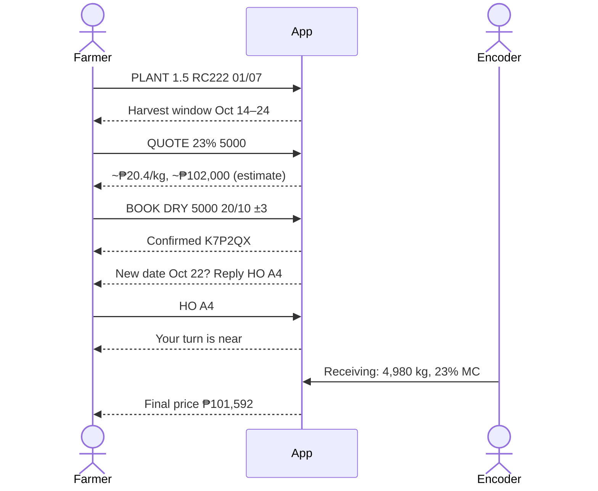
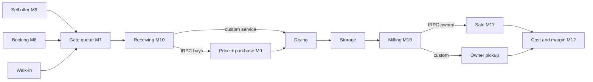
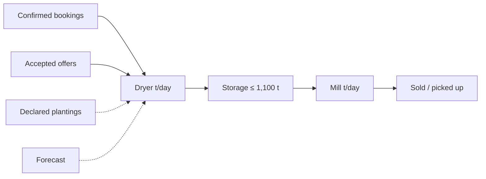

# PRD: Post-Harvest Facility Capacity Planning Platform

## Summary

IRPC can't see palay coming until it reaches the gate. At peak, dryers overflow and farmers go to private mills. Off-season, machines idle while power costs keep running.

This web app with an SMS channel shows IRPC what's coming weeks ahead and suggests what to do:

1. **Clients report what's coming.** By SMS, they report plantings, book drying or milling slots, offer palay for sale, and get price quotes. A co-op leader, relative or staff member can act for them.
2. **The plant sees the next weeks.** Bookings, plantings and a harvest forecast feed a capacity page for dryers, storage and mill. Busy and idle days show early.
3. **The app suggests actions.** It can move flexible bookings off busy days, store dried palay and mill it later, mill in full loads to save power, or text farmers before idle stretches.
4. **Staff run the day.** Booked clients and walk-ins share one gate queue. Staff record each stage on forms that mirror the paper ones, or from a photo. Bought palay is priced on the spot. Each batch shows its cost, its margin and its buyers.

IRPC is the first facility. Nothing about IRPC, rice or Iloilo is hardcoded, so other facilities, crops and regions only need their own data.

A farmer's journey by SMS (figures illustrative):

## Glossary

| Term                 | Meaning                                                                              |
| -------------------- | ------------------------------------------------------------------------------------ |
| Facility             | A plant that dries, stores and processes a crop. IRPC is the first.                  |
| Palay                | Unhusked rice. Wet palay is dried, then stored, then milled.                         |
| MC                   | Moisture content (%). Palay arrives at about 23% and is dried to about 14%.          |
| Client               | A farmer, co-op, trader, store or institution. May own palay, buy rice, or both.     |
| Booking              | A reserved drying or milling slot on a future day.                                   |
| Queue                | The gate order on the day, shared by booked clients and walk-ins.                    |
| Sell offer           | A client's offer to sell palay to IRPC.                                              |
| Booker               | Whoever books or offers: the client, a co-op leader, a relative, or staff.           |
| Planting declaration | A farmer's report of place, hectares, variety and planting date.                     |
| Capacity pool        | Dryer (t/day), storage (t held) or mill (t/day).                                     |
| Prescription         | An action suggested from capacity numbers. A manager accepts, edits or dismisses it. |
| Batch                | One lot of palay, tracked from the gate to the buyers of its rice.                   |
| First-hand buyer     | Anyone who buys from, or takes first delivery from, the mill.                        |
| Encoder              | Staff who run the queue and record receiving, drying, milling and sales.             |

## Problem

- **Peak (Sep–Oct, Jan–Feb):** palay arrives faster than the dryers can take it. Farmers wait or go to private mills. Staff only learn of overloads when trucks arrive.
- **Off-season (Apr–Jul):** dryers and mill sit nearly idle. The mill runs partial loads, and base power keeps drawing.
- **No batch cost:** cost, electricity included, is known only after the monthly books close.
- **Paper records:** the queue, storage level and batch history are buried in logbooks and tally sheets.
- **Farmers:** they can't see prices, rates or open slots, so they call or show up and hope.

## Modules

Each module is a vertical slice that one person owns end to end: screens, SMS, logic, data, demo and docs. The wording uses the rice pilot. "Milling" and "palay" come from crop settings.

**P0** must work in the demo. **P1** comes after all P0. **P2** is a static mock at most.

| Module                  | Purpose                                    | Main users                | Needs                        |
| ----------------------- | ------------------------------------------ | ------------------------- | ---------------------------- |
| M1. Facility Setup      | Machines, crops, places, settings          | Admin                     | None                         |
| M2. Accounts and Access | Clients, staff, permissions                | Everyone                  | None                         |
| M3. SMS                 | Sending, receiving and understanding texts | Clients, bookers          | M2                           |
| M4. Language            | Hiligaynon and English                     | Everyone                  | None                         |
| M5. Pricing             | Buying prices, fees, rice prices           | Manager, clients          | M3, M4                       |
| M6. Booking             | Future drying and milling slots            | Clients, bookers, encoder | M1, M2, M3, M4               |
| M7. Queue               | Gate order on the day                      | Encoder, clients          | M2, M3, M6                   |
| M8. Harvest Forecast    | Expected arrivals                          | Clients, bookers, manager | M1, M2, M3, M4               |
| M9. Palay Buying        | Quotes, prices, purchases                  | Clients, encoder, manager | M2, M3, M5, M10              |
| M10. Batch Records      | Digital paper forms, gate to storage       | Encoder, manager, clients | M1, M2, M7                   |
| M11. Sales and Dispatch | Selling rice, tracing batches              | Encoder, manager, buyers  | M3, M5, M9, M10              |
| M12. Batch Costing      | Cost and margin per batch                  | Manager                   | M1, M5, M9, M10, M11         |
| M13. Capacity           | Load against capacity, several views       | Manager                   | M1, M6, M7, M8, M9, M10, M12 |
| M14. Prescriptions      | Suggested actions                          | Manager, clients          | M3, M6, M12, M13             |

Main flow:

Plan, act, re-plan:

### M1. Facility Setup

All settings are editable, since some IRPC figures are unconfirmed and new facilities should need only settings.

**P0**

- Capacity: dryers and their load size, drying cycle hours, mill t/hour, operating hours, storage (1,100 t for IRPC).
- Costs: machine kW, plant base load (power drawn on any working day), ₱/kWh, labor ₱/hour.
- Planning: target MC, drying shrink factor, idle threshold, harvest-window and tonnage range widths.
- Crops: needs drying or not, target MC, processing-step name (milling), output grades and by-products.
- Varieties: days to maturity, yield per hectare.
- Places: the PSGC list, so any province works.
- Demo data: IRPC, with sample clients, co-ops and buyers.

**P2**

- Setup screens to add a facility, crop or region without a developer.

### M2. Accounts and Access

**P0**

- Register clients (farmers, co-ops, traders, stores, institutions) with name, place and contact phone. Farmers also have a barangay, co-op and language. Staff can register walk-ins in seconds, and farmers can self-register by SMS.
- Link bookers to the clients they act for.
- Every screen action and SMS command is checked against the table below. A refused text gets a polite reply.

**P1**

- A client approves by SMS the first time someone books for them by SMS. Links that staff make in person skip this.
- Staff see only clients who've dealt with their facility.
- Staff belong to a facility. Clients can use several facilities.

**P2**

- A log of record changes.

| Action                                                                | Client (SMS) | Booker (SMS)   | Encoder | Manager | Admin  |
| --------------------------------------------------------------------- | ------------ | -------------- | ------- | ------- | ------ |
| Check prices and fees                                                 | Yes          | Yes            | Yes     | Yes     | Yes    |
| Book, declare planting, offer palay                                   | Self         | Linked clients | Anyone  | Anyone  | Anyone |
| Cancel, answer or check a booking                                     | Own          | Ones they made | Yes     | Yes     | Yes    |
| Run the gate queue                                                    |              |                | Yes     | Yes     | Yes    |
| Register clients, record stages and sales                             |              |                | Yes     | Yes     | Yes    |
| See costs and margins                                                 |              |                |         | Yes     | Yes    |
| Set prices, override buying prices, act on suggestions, send outreach |              |                |         | Yes     | Yes    |
| Facility settings, staff, SMS simulator                               |              |                |         |         | Yes    |

Co-op leaders are bookers linked to their members. Buyers have no login and only receive texts.

### M3. SMS

Shared texting plumbing. Modules register their own commands and templates.

**P0**

- Route incoming keyword commands to their module, identifying the sender by phone. Unknown texts get a help reply.
- Send texts from templates.
- A phone simulator page, so the demo doesn't depend on a network. It's admin-only and off when a real gateway is on.

**P1**

- A real SMS gateway.
- Plain-language texts. AI reads non-command texts (Hiligaynon, English or Taglish, converting sacks to kilos), replies with what it understood, and saves nothing until the sender confirms.

### M4. Language

**P0**

- All screens and SMS templates in Hiligaynon and English.
- Texts use each person's language.

**P1**

- A language switch on every screen.
- New languages, such as Cebuano or Tagalog, need only a translation file, keywords included.

### M5. Pricing

**P0**

- The manager sets today's prices:
  - Palay buying: a base price at a reference MC (25% for IRPC), plus deduction rates for damaged grains, immature grains, foreign matter and sacks.
  - Fees: drying ₱1.60/kg, milling ₱3.30/kg (IRPC's current rates).
  - Rice selling price per grade.
- Prices are kept by date, so each batch is costed at its own day's prices.
- `PRICE` and `RATES` texts return today's figures.

**P1**

- A public mobile price page.
- A price history screen.

### M6. Booking

Slots reserved ahead. The day itself belongs to M7.

**P0**

- Book a drying or milling slot with estimated kilos, preferred date, and how many days either way the client can move. Farmers, co-ops and traders can all book.
- Book for someone else. The booking records both the booker and the client.
- A list of upcoming bookings per service and day.
- A booking confirms automatically if the day has room among confirmed bookings. Otherwise staff confirm it or propose another date.
- Texts: request received, confirmed (with a reference code), new date proposed (reply to accept or decline).

**P1**

- Change or cancel by SMS.
- Web booking, with phone sign-in.

**P2**

- A co-op leader's view of members' bookings.

Statuses: requested, confirmed, new date proposed, arrived, cancelled, no-show.

### M7. Queue

**P0**

- Check in by booking code or phone, or add a walk-in. Check-in marks the booking arrived.
- One line per service: drying, milling, and palay sold to IRPC.
- A live screen showing who's next, who's being served, and how long each has waited.
- Start and finish service. Starting hands the client to receiving (M10) and texts the next few in line.

**P1**

- `STATUS` by SMS returns the client's place in line.
- An estimated wait.

**P2**

- A queue board for the waiting area.

### M8. Harvest Forecast

Expected arrivals per day, from farmer reports plus a forecast for everyone else.

**P0**

- Farmers, co-op leaders or staff report plantings: place, hectares, variety, date.
- Each report gets a harvest window (planting date + days to maturity, ± a few days) and a tonnage range (hectares × yield), and the farmer gets the window by text.

**P1**

- A model that forecasts harvest per municipality per half-month about 80 days ahead, from municipal planting reports.
  - It's trained on real OPA 2025 planting and harvest data, with no synthetic training data. Harvest comes about 100 days after planting.
  - Harvest × IRPC's usual share of each municipality = expected arrivals.
  - It's shown as a lower-confidence layer, with error ranges and accuracy measured on held-out municipalities.
- Import planting and harvest reports in one standard file format, for any province.
- Without a current planting report, fall back to last year's harvest × share.

### M9. Palay Buying

Private mills win on fast, clear quotes and payment. This module is IRPC's answer.

**P0**

- An SMS quote: a farmer sends estimated MC (and kilos, optionally) and gets an estimated price per kilo and total, which the final weighing and quality check confirm.
- Price at receiving, computed like the paper Receiving Report from weight, MC, damaged and immature grains, foreign matter and sacks. Shown to the encoder and texted to the farmer.
- A purchase record: kilos, price, total, deductions, payment voucher number. The app doesn't make payments.

**P1**

- Sell offers by SMS (variety, kilos, harvest date). They appear on a buying list and as expected arrivals. The manager accepts or declines.
- A manager can override a price, with a reason.
- A buying budget: working capital used and remaining.

**P2**

- A purchase history for each farmer.

### M10. Batch Records

The paper forms, digitized: one lot from the gate to milled rice in storage.

**P0**

- Stages: received → drying → stored → milling → milled → released → closed.
  - "Stored" is dried palay in storage, "milled" is rice in storage, and "released" means everything has been picked up or sold.
  - Palay that arrives already dry skips drying.
- Receiving starts from the queue entry, which links the batch to its client and booking.
- Stage forms match the paper fields:
  - Receiving: tally sheet and stock receipt numbers, bags, gross and net weight, variety, MC, damaged, immature, foreign matter.
  - Drying: dryer, MC before and after, start and end time, dried weight, bags.
  - Milling: kilos in, start and end time, output per grade, by-products.
- Shrink and recovery (rice out ÷ palay in) are calculated automatically.
- Ownership: custom service (the client's palay) or IRPC-owned (bought).

**P1**

- Photo to form: AI fills in a stage form from a photo, and the encoder checks it.
- Entry checks: more out than in, MC out of range, kilos that don't match the bag count.
- Clients confirm weight and MC by SMS after receiving and after drying.
- Storage stock by variety and age.

**P2**

- Locked closed batches, with corrections logged as amendments.

### M11. Sales and Dispatch

**P0**

- Rice stock by grade, from M10.
- Record a sale: buyer, grade, kilos, price, and official receipt or invoice number. Source batches are picked oldest first, and staff can change the pick. A sale can span several batches, and a batch can go to several buyers.
- Buyers are clients with a type: wholesaler, retailer, institution, municipal drop-point, or the ₱20/kg program.
- Trace a batch by batch number, client or buyer: gate, stages, purchase and sales.

**P1**

- Orders: a buyer reserves stock and gets a text when it's ready.
- Sales by buyer type and place.

**P2**

- A purchase history for each buyer.

### M12. Batch Costing

Margin per batch at close, not month-end.

**P0**

- Electricity = machine hours (from stage times) × kW × ₱/kWh.
- Labor and other direct costs, from set rates or entered per batch.
- Revenue:
  - Custom service: drying fee × wet kg + milling fee × rice kg.
  - IRPC-owned: the batch's sales (M11) − its purchase cost (M9).
- Cost, revenue and margin per batch and per kilo.

**P1**

- Electricity ₱/kg over time.

**P2**

- Manual meter readings to check the estimates.

### M13. Capacity

The manager's main page: several views of the same numbers.

All views:

- Show three pools: dryer (wet palay in, t/day), storage (dried palay held, of 1,100 t) and mill (t/day).
- Label each number's source (confirmed booking, accepted offer, declared planting, forecast) and give a low–high range. Demo forecast data is labelled.
- Flag overloaded days with the overflow in tonnes, and flag idle stretches.
- Open the same breakdown on click: amount by source, the bookings behind it, and that day's suggestions.

What feeds the pools (solid = firm, dashed = estimate; only firm sources trigger overload):

**P0**

- Headline numbers: dryer and mill use, overloaded and idle days ahead, electricity ₱/kg.
- Chart: stacked load per day by source, with a capacity line.
- Days: a grid with one row per pool and one column per day.

**P1**

- Season: a monthly heatmap for the year, real for past months and forecast for future ones.
- Map: expected harvest per municipality over the next 4–8 weeks, as bubbles.
- Today: a timeline per dryer and the mill, from M7 and M10.

**P2**

- Flow: arrivals → dryers → storage → mill for a week, showing the bottleneck.
- Volume by municipality and buyer type, with a CSV export.

### M14. Prescriptions

Computed from M13. The manager accepts, edits or dismisses each.

**P0**

- **Move bookings off a busy day:** move flexible bookings to the nearest days with room. Accepting texts the clients through M6.
- **Mill in full loads:** mill stored palay on fewer, full days. Shows ₱/kg against spreading it over partial days.

**P1**

- **Store now, mill later:** at peak, store dried palay and suggest milling dates in a quieter week.
- **Fill idle days:** before an idle stretch, suggest texting current rates and buying prices to chosen farmers, co-ops or municipalities.

**P2**

- **Plain-language summaries:** AI writes one or two sentences per suggestion, using only the computed numbers.

## Rules for every module

- **Settings, not code:** facility, crop, region and language are data.
- **AI reads, people confirm:** AI only reads texts and photos. All capacity, suggestion and cost numbers come from fixed rules.
- **Permissions:** M2's table applies to screens and SMS alike.
- **No official receipts:** the app only stores receipt or invoice numbers.
- **Cheap to run:** mobile web, SMS for basic phones, no new plant hardware, meter readings typed in.

## Out of scope

- A buyer portal or online ordering.
- Paying farmers: vouchers, disbursement, accounts payable. M9 stores only the voucher number.
- Issuing official receipts, an accounting ledger, or cash tracking.
- Links to RSBSA, MAO records or MoRProGRes. The data keeps IDs for later.
- Meters, sensors or other new plant hardware.
- Weather-based or deep-learning forecasts.
- Predicting IRPC arrivals directly, since there's no dated arrival history.
- Native apps and full offline mode.
- Trucking and warehouse rental.
- Running the ₱20/kg program. Here it's only a buyer type.
- Dynamic pricing.
- Chatbots.
- Multi-facility dashboards. The data allows them later.
- Crops that don't follow receive → dry (optional) → store → process → dispatch, such as cold-chain produce.
- Data Privacy Act compliance (consent, data handling, AI terms). It's deferred to the pilot.

## Open questions

**Plant figures to confirm with IRPC** (editable settings until then):

| Figure            | What we have                                                                    |
| ----------------- | ------------------------------------------------------------------------------- |
| Drying capacity   | 40 t/load (feasibility study: 5 × 8 t) or 56 t (spec sheet: 5 × 10 t + 1 × 6 t) |
| Drying cycle time | Not recorded                                                                    |
| Mill throughput   | 400 bags/day (spec sheet) or 50 t/day (challenge form). Sample run: ~3.1 t/h.   |
| Machine kW        | Unknown                                                                         |
| Electricity price | Unknown                                                                         |

- **Buying price rule:** the Receiving Report shows a base price at 25% MC, less damaged × 0.25, immature × 0.10, foreign matter and sacks. How MC away from 25% changes the price is unwritten, so it's a setting until confirmed.
- **Reschedules:** will farmers accept new dates? That limits the "move bookings" suggestion.
- **Forecast trust:** it's trained on one season, so year-to-year drift is untested. It's accurate at province level but noisy per municipality and half-month. Batad, Maasin and San Dionisio have inconsistent totals.
- **IRPC's share:** it comes from 2021–2023 purchases applied to 2025 harvests. Newer purchase data would settle it.
- **Not explicitly confirmed:** plant staff are the primary users, farmers secondary.
