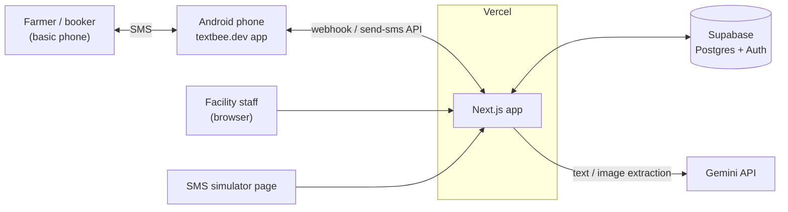
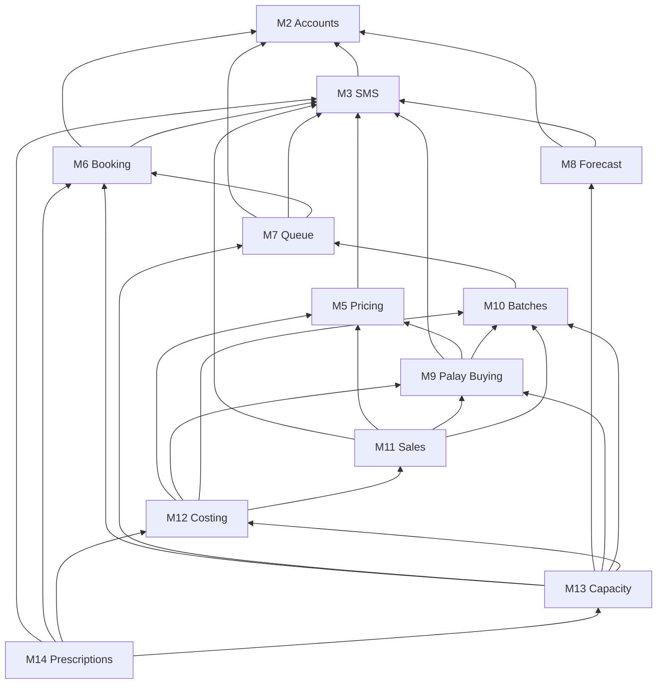
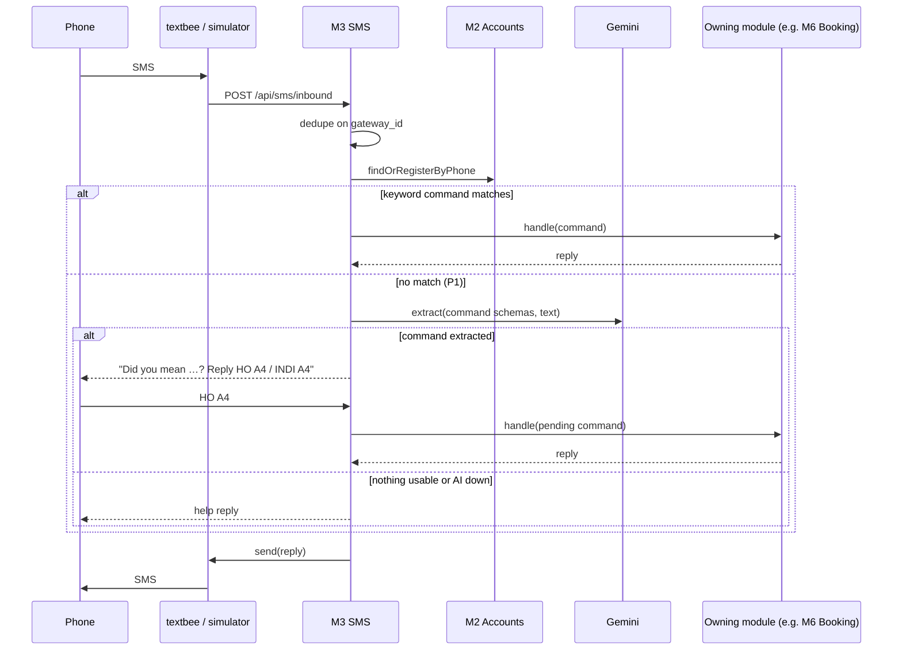
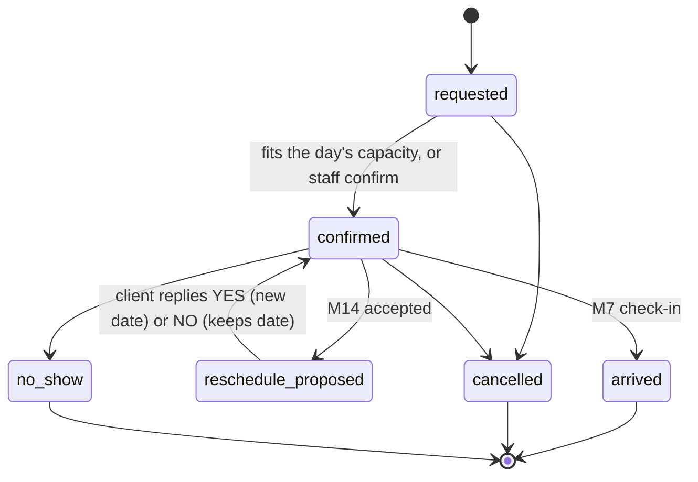
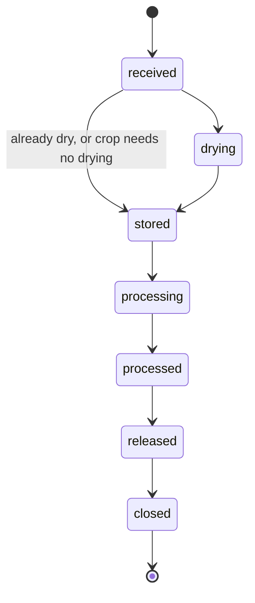

# TRD: Post-Harvest Facility Capacity Planning Platform

How we build the [PRD](PRD.md). Module numbers (M1–M14) match.

## Summary

- One Next.js app on Vercel, with Supabase for the database and auth. All free tiers.
- One folder per module, holding its screens, logic, data, SMS and tests.
- Clients use SMS through textbee.dev. The demo runs on a built-in simulator.
- AI (Gemini) only turns texts and photos into structured data, and a person confirms it.
- The forecast is trained offline in Python. The app reads only the exported parameters.
- No IRPC- or rice-specific code. Facilities, crops and regions are data.

## Stack

| Part              | Choice                                                        | Why                                                |
| ----------------- | ------------------------------------------------------------- | -------------------------------------------------- |
| App               | Next.js (App Router), strict TypeScript, server actions       | One app for screens and the SMS webhook            |
| UI                | Tailwind, shadcn/ui, shadcn charts                            | Matches our design system                          |
| Database, auth    | Supabase: Postgres, Auth, RLS                                 | Free, hosted, per-row access rules                 |
| Data access       | supabase-js, `supabase gen types`, Supabase CLI migrations    | No ORM, so queries run as the user and RLS applies |
| Validation        | Zod                                                           | One schema per form, SMS command and AI result     |
| i18n              | next-intl, one file per locale (`en`, `hil`)                  | Also serves SMS templates and keywords             |
| SMS               | textbee.dev (Android phone and SIM), plus a web simulator     | Free tier, inbound webhook, no sender-ID approval  |
| AI                | Vercel AI SDK with `@ai-sdk/google` (Gemini Flash, free tier) | Structured output from Zod schemas                 |
| Hosting           | Vercel Hobby, Supabase `ap-southeast-1`                       | Free, and the region nearest the Philippines       |
| Forecast training | Python (pandas, openpyxl, SciPy), offline                     | Exports the M8 parameters                          |
| Tooling           | pnpm, Vitest, ESLint, Prettier, commitlint                    |                                                    |

Scaffold with `create-next-app` and `shadcn init`, then pin versions.

## System context



## Code layout

```
src/
  app/                    pages and API routes only, calling into modules
  modules/
    facility-setup/       M1
    accounts/             M2
    sms/                  M3
    language/             M4
    pricing/              M5
    booking/              M6
    queue/                M7
    harvest-forecast/     M8
    palay-buying/         M9
    batches/              M10
    sales/                M11
    batch-costing/        M12
    capacity/             M13
    prescriptions/        M14
  lib/                    Supabase client, SMS gateway, AI helper, UI kit
supabase/migrations/      <timestamp>_<module>.sql
data/forecast/            Python: parse OPA data, train M8
messages/<locale>.json    UI text, SMS templates and keywords, by module
```

| File          | Contents                                      |
| ------------- | --------------------------------------------- |
| `index.ts`    | The only exports other modules may import     |
| `logic.ts`    | Pure functions (math, rules), the test target |
| `queries.ts`  | Reads                                         |
| `actions.ts`  | Server actions (writes)                       |
| `sms.ts`      | The module's SMS commands and templates       |
| `components/` | Screens and widgets                           |
| `*.test.ts`   | Tests                                         |

- Modules call each other's `index.ts` directly. There's no event bus, queue or cron.
- Dependencies point one way, so there are no cycles. An action that spans modules is orchestrated in its `src/app` server action. For example, saving the receiving form calls M10 `saveReceiving`, then M9 `createPurchase` for bought palay.

Dependencies (M1 and M4 omitted, since nearly all modules use them):



## Rules for all code

- **Tenancy:** every settings and operations table has `facility_id`. A new facility is new rows, with no new code or deploy.
- **No domain in code:** crop names, stage labels, grades, form fields, places, languages, buyer types and prices live in tables or translation files.
- **Units:**
  - Weight: integer kg.
  - Money: integer minor units (`_minor`, centavos for PHP, per `facilities.currency`).
  - MC: `numeric(4,1)` %.
- **Time:** the facility's time zone (Asia/Manila). Columns are `date` or `timestamptz`.
- **Every table:** `id` (UUID), `created_at`, `updated_at`.
- **Access:** every action and SMS command calls M2 `can()`. RLS is on for every table as a backstop.
- **Service role key:** only the SMS webhook and seed use it.

## Shared plumbing

### Auth

- Staff use Supabase email and password. Accounts come from the seed, with email confirmation off.
- Clients and bookers are identified by phone over SMS. Web login by SMS one-time code is P1.

### SMS gateway (`lib`)

```ts
interface SmsGateway {
  send(to: string, body: string): Promise<{ id: string }>;
}
```

- `SimulatorGateway`:
  - Only stores messages, and shows a phone screen per number.
  - It's admin-only and disabled when `SMS_GATEWAY=textbee`, since it can impersonate any phone.
- `TextbeeGateway`:
  - Sends through textbee's `send-sms` API.
  - Inbound texts arrive at `POST /api/sms/inbound`, deduped on the gateway message ID.
- Each facility has its own gateway phone (`facilities.sms_device_id`), which routes inbound texts to that facility.

### AI helper (`lib`)

- `extract(schema, input)` sends text or an image to Gemini and returns data matching the Zod schema.
- A person confirms all output before it's saved.
- On failure or rate limit, the app falls back to a help text or an empty form.

### i18n (`lib`)

- Keys use `<module>.<key>`. Crop words come from keys on the crop (`crops.rice.processing` = "Milling").
- SMS keywords live in the translation files, so each language brings its own.
- SMS uses next-intl `createTranslator`. Templates use GSM-7 only, max 2 segments (320 characters).

## Data model

Keys and links only; module sections list the columns. Settings and operations tables have `facility_id`, but only the main links are drawn. `crops`, `varieties`, `localities`, `profiles` and `clients` are shared across facilities. These tables are not drawn:

- `prices`
- `catchment_shares`
- `regional_crop_stats`
- `forecast_params`
- `orders`


## Modules

Technical details only. The PRD lists features.

### M1. Facility Setup

| Table        | Columns                                                                                                                                                                                                                                                                                                                                                    |
| ------------ | ---------------------------------------------------------------------------------------------------------------------------------------------------------------------------------------------------------------------------------------------------------------------------------------------------------------------------------------------------------- |
| `facilities` | `name`, `locality_id`, `timezone`, `currency`, `default_locale`, `sms_device_id`, `storage_capacity_kg`, `operating_hours_per_day`, `base_load_kw`, `tariff_minor_per_kwh`, `labor_minor_per_hour`, `shrink_factor`, `idle_threshold_pct`, `forecast_window_days`, `forecast_range_pct`, `notify_ahead_n`, `buyer_types` (jsonb), `doc_ref_fields` (jsonb) |
| `machines`   | `facility_id`, `stage` (`drying`, `processing`), `code`, `capacity_kg` (per load, dryers), `cycle_hours`, `kg_per_hour` (processing), `rated_kw`, `active`                                                                                                                                                                                                 |
| `crops`      | `code`, `name_key`, `requires_drying`, `target_final_mc`, `processing_label_key`, `output_types` (jsonb: main output, grades, by-products)                                                                                                                                                                                                                 |
| `varieties`  | `crop_id`, `code`, `name`, `maturity_days`, `default_yield_kg_per_ha`                                                                                                                                                                                                                                                                                      |
| `localities` | `psgc_code`, `name`, `level`, `parent_id`, `lat`, `lng`                                                                                                                                                                                                                                                                                                    |

| Column               | Meaning                                              |
| -------------------- | ---------------------------------------------------- |
| `base_load_kw`       | Power drawn on any working day, whatever the volume  |
| `shrink_factor`      | Drying loss beyond water (handling, cleaning)        |
| `idle_threshold_pct` | Load below this share of capacity is idle            |
| `notify_ahead_n`     | How many in line get "turn is near"                  |
| `doc_ref_fields`     | Paper-form numbers recorded (IRPC: WTS no., WSR no.) |

**Exports:** `getFacility(id)`, `dryingCapacityKgPerDay(facility, machines)`, `processingCapacityKgPerDay(facility, machines)`.

- Drying per day = Σ active dryers' `capacity_kg` × ⌊`operating_hours_per_day` ÷ `cycle_hours`⌋.
- Processing per day = Σ active processors' `kg_per_hour` × `operating_hours_per_day`.
- Crops with `requires_drying = false` skip the dryers.

**Seed (`pnpm seed`):**

- PSGC places for Western Visayas.
- Rice:
  - Its varieties, MC target and "milling" label.
  - Grades: WMR, dasdas and brown rice.
  - By-products: bran, brewer and broken.
- IRPC:
  - Dryers of 5 × 10 t + 1 × 6 t (the 40 t alternative in a comment).
  - One mill.
  - Its form fields and buyer types.
- Staff accounts.
- About 30 farmers in 3 Pototan co-ops, with approved booker links.
- Traders and stores, plus buyers modelled on IRPC's anonymized top-20 list.
- Today's prices, accepted sell offers and a live queue.
- A peak scenario with at least one overloaded day and one idle stretch.

### M2. Accounts and Access

There are two kinds of record:

- **Profiles** are people with phones: farmers, bookers, staff.
- **Clients** are business parties: farmer, co-op, trader, store or institution. Each has a contact profile. A farmer is both a client and a profile.

| Table               | Columns                                                                                                                        |
| ------------------- | ------------------------------------------------------------------------------------------------------------------------------ |
| `profiles`          | `auth_user_id` (only for logins), `name`, `phone` (E.164, unique), `locale`, `locality_id`, `registry_ids` (jsonb, e.g. RSBSA) |
| `clients`           | `kind`, `name`, `contact_profile_id`, `locality_id`, `coop_id`, `buyer_type`                                                   |
| `client_facilities` | `client_id`, `facility_id`, `first_seen_at`, written on first booking, check-in, sale or purchase                              |
| `facility_members`  | `facility_id`, `profile_id`, `role` (`encoder`, `manager`, `admin`)                                                            |
| `booker_links`      | `booker_profile_id`, `client_id`, `status` (`pending`, `approved`), `created_by` (`sms`, `staff`)                              |

**Exports:** `findOrRegisterByPhone(phone)`, `resolveClient(sender, forPhone?)`, `can(actor, action, resource)`.

**`resolveClient`** resolves a `FOR <phone>` suffix to a client:

- An approved link returns the client.
- Otherwise it creates a `pending` link and texts the client an approval prompt, holding the command until `HO <code>` (P1).
- At P0, links auto-approve. Staff-made links are approved immediately.

**`can()`** is a pure function encoding the PRD permission table. Every server action and SMS handler calls it first.

- Actors: staff, with their role at the facility, or an SMS sender, with their linked clients.
- Actions: `booking.create`, `booking.cancel`, `queue.checkIn`, `batch.record`, `price.set`, `purchase.override`, `sale.record`, `cost.view`, `prescription.decide`, `facility.configure`, `simulator.use`, and so on.
- On refusal, SMS replies with `accounts.notAllowed` and actions throw.

**RLS** backs up `can()` for reads:

- Staff read and write operations rows for their facilities.
- Staff see clients only through `client_facilities` (P1; at P0, all clients).
- Only managers and admins see costs, and only admins write settings.
- Web clients (P1) see rows they own, booked, or are approved-linked to.
- SMS handlers use the service role, which bypasses RLS, so `can()` is mandatory there.

**Tests:** `can()` for every row of the permission table, including a stranger cancelling someone's booking.

### M3. SMS

- `sms_messages`: `direction`, `phone`, `body`, `gateway_id` (unique), `parsed` (jsonb), `via_ai`, `status`.
- `sms_prompts`: `phone`, `code` (2 characters), `kind` (`ai_confirm`, `link_approval`, `reschedule`), `payload` (jsonb), `expires_at`, `status`. There's one row per yes/no question sent.

**Exports:** `registerCommand({ keywords, schema, parse, handle })`, `sendTemplate(profile, key, vars)`.

**Yes/no replies:** every question ends with its code ("Reply HO A4 or INDI A4"). A bare `HO`, `YES`, `INDI` or `NO`:

1. answers the phone's only open prompt;
2. if several are open, gets a text asking which one, listing their codes;
3. if none are open, gets the help text.

Prompts expire after 24 hours. `YES <booking ref>` also answers reschedule prompts.

**Inbound flow:**



1. Find or register the sender.
2. Match a keyword command, check `can()`, and hand off to the owning module.
3. With no match (P1), Gemini maps the text to a command. The app replies "Did you mean …?" with a code and waits for `HO <code>`.
4. Otherwise, send the help text.

**Tests:** keyword parsing.

### M4. Language

- `t(profile, key, vars)` returns SMS text in the profile's locale, falling back to the facility default.
- Web screens get their locale from a cookie or the profile.
- Locales are the files in `messages/`.
- A native speaker must check all Hiligaynon text and keywords.

### M5. Pricing

`prices` is append-only, with one row per facility, crop and `effective_date`.

| Column                        | Meaning                                                                                      |
| ----------------------------- | -------------------------------------------------------------------------------------------- |
| `buy_base_minor_per_kg`       | Palay buying price at the reference MC                                                       |
| `buy_reference_mc`            | 25% for IRPC                                                                                 |
| `buy_rules` (jsonb)           | Deductions (`{ damaged: 0.25, immature: 0.10, foreign: 1.0, sack_kg: 0.1 }`) and the MC rule |
| `drying_fee_minor_per_kg`     | Per wet kg                                                                                   |
| `processing_fee_minor_per_kg` | Per kg of rice out                                                                           |
| `sell_minor_per_kg` (jsonb)   | Per grade, e.g. `{ WMR: 4700 }`                                                              |

**Exports:** `priceOn(facilityId, cropId, date)`. Dated prices are P0 because M12 needs them. The history screen is P1.

**SMS:** `PRICE` / `PRESYO`, `RATES` / `BAYAD`.

### M6. Booking

`bookings` columns:

- `facility_id`, `crop_id`
- `ref` (a 6-character code)
- `type` (`drying`, `processing`)
- `client_id`, `booker_profile_id`
- `channel` (`sms`, `staff`, `web`)
- `est_kg`, `preferred_date`, `flex_days`, `scheduled_date`
- `status`

**Exports:** `bookingsBetween(from, to)`, `findByRef(ref)`, `proposeReschedule(bookingId, date)`, `markArrived(bookingId)`.

**Confirmation:**

- A booking auto-confirms if that day's confirmed bookings plus this one fit M1 capacity. The check uses M6's own data, so there's no M13 dependency.
- Otherwise it stays `requested`, the client gets a "request received" text, and staff confirm or propose a date.

**Status changes** (`logic.ts` rejects all others):



**SMS:**

| Command | Format                                               | Example                  |
| ------- | ---------------------------------------------------- | ------------------------ |
| Book    | `BOOK DRY\|<processing word> <kg> <dd/mm> [±<days>]` | `BOOK DRY 5000 20/10 ±3` |
| Answer  | `YES <ref>` / `NO <ref>`                             | `YES K7P2QX`             |
| Cancel  | `CANCEL <ref>`                                       | `CANCEL K7P2QX`          |

- `FOR <phone>` books for someone else.
- Aliases: `RESERBA`, `HO`, `INDI`.
- The processing word comes from the crop (`MILL` / `GALING`).
- Only the client's contact or an approved booker can answer or cancel.

### M7. Queue

`queue_entries` columns:

- `facility_id`
- `service` (`drying`, `processing`, `selling`)
- `client_id`, `booking_id` (empty for walk-ins), `offer_id`
- `checked_in_at`, `started_at`, `finished_at`
- `status` (`waiting`, `serving`, `done`, `left`), `position`

**Exports:** `checkIn({ bookingRef | phone | walkIn })`, `start(entryId)`, `finish(entryId)`, `lineFor(service)`.

- `checkIn` appends to the service's line and calls M6 `markArrived` for bookings.
- `start` marks the entry as serving and texts the next `notify_ahead_n` clients. M10's receiving form opens from the started entry.
- The line is first come, first served at P0. Priority for booked clients is a later setting.
- The live screen updates through Supabase Realtime, or by polling.

**SMS (P1):** `STATUS` returns the sender's place in line.

**Tests:** line order and the recipients of "turn is near".

### M8. Harvest Forecast

There are two sources: declared plantings (farm level) and a model for everyone else (municipality level).

| Table                   | Columns                                                                                                                                                         |
| ----------------------- | --------------------------------------------------------------------------------------------------------------------------------------------------------------- |
| `planting_declarations` | `client_id`, `booker_profile_id`, `locality_id`, `area_ha` (`numeric(6,2)`), `variety_id`, `planted_on`                                                         |
| `regional_crop_stats`   | `locality_id`, `crop_id`, `period_start`, `period_end`, `kind` (`planted`, `harvested`), `area_ha`, `production_kg`, `source` (`opa-2025`, `demo-synthetic`, …) |
| `forecast_params`       | `crop_id`, `locality_id` (null = province), `lag_weights` (jsonb), `yield_kg_per_ha`, `residual_p10`, `residual_p90`, `trained_on`, `metrics` (jsonb)           |
| `catchment_shares`      | `facility_id`, `crop_id`, `locality_id`, `share`                                                                                                                |

`regional_crop_stats` and `forecast_params` are regional and shared by facilities.

**Exports:** `expectedArrivals(facilityId, from, to)` returns kg per day for each source (`declared`, `forecast`), each with low and high values.

**Declared plantings:**

- Harvest window = `planted_on` + `maturity_days` ± `forecast_window_days`.
- kg = `area_ha` × yield ± `forecast_range_pct`, weighted toward the middle of the window.

**Model** (municipalities harvest about 100 days after planting):

- harvest(m, t) = Σₖ wₖ × planted(m, t − k) × yield(m), with k = 5–9 half-months.
- arrivals = harvest × `catchment_shares.share`, spread evenly within each half-month.
- The range comes from held-out residuals (p10 to p90).
- Fallback order:
  1. The municipality's own parameters.
  2. Pooled parameters, for flagged municipalities.
  3. Last year's harvest × share, when there's no planting report.

**SMS:** `PLANT <ha> <variety> <dd/mm>` / `TANOM …`, with optional `FOR <phone>`.

**Data loading:**

- `pnpm import:stats <file.csv>` takes one format for all regions: `psgc_code, crop, period_start, period_end, kind, area_ha, production_kg, source`. Each new source needs a converter.
- `pnpm import:model <params.json>`.
- `share` = IRPC's 2021–2023 purchases from a municipality ÷ that municipality's yearly harvest.

**Training** (`data/forecast/`, by hand):

1. Parse the OPA file (see the appendix).
2. Fit:
   - Lag weights with non-negative least squares, pooled across municipalities.
   - Yield per municipality = t harvested ÷ ha harvested.
   - Batad, Maasin and San Dionisio (harvested under 70% of planted) use the pooled parameters.
3. Evaluate leave-one-municipality-out, storing the results in `metrics`.
4. Export `params.json` and the cleaned CSV.

First run:

| Result                        | Value                          |
| ----------------------------- | ------------------------------ |
| Weights for lags 5–9          | ≈ 0.15, 0.41, 0.31, 0.09, 0.03 |
| Planting to harvest           | ≈ 100 days                     |
| R², province                  | ≈ 0.91                         |
| R², municipality × half-month | ≈ 0.5                          |
| Lead time                     | ≈ 80 days                      |

**Demo data:** a 2026 planting report generated from 2025 data:

- Each municipality is shifted by up to ±1 half-month and scaled by up to ±15%.
- It's stored as `demo-synthetic` and labelled in the UI.
- It's never used for training or evaluation.

**Tests:** the kernel with fixed parameters, the fallback order, and the declared-window math.

### M9. Palay Buying

| Table         | Columns                                                                                                                                                                                                |
| ------------- | ------------------------------------------------------------------------------------------------------------------------------------------------------------------------------------------------------ |
| `sell_offers` | `facility_id`, `crop_id`, `client_id`, `booker_profile_id`, `variety_id`, `est_kg`, `harvest_date`, `status` (`offered`, `accepted`, `declined`, `arrived`, `withdrawn`)                               |
| `purchases`   | `facility_id`, `batch_id`, `client_id`, `price_date`, `net_kg`, `paid_kg`, `price_minor_per_kg`, `total_minor`, `deductions` (jsonb, kg per reason), `override_reason`, `overridden_by`, `voucher_ref` |

**Exports:** `quote(facilityId, cropId, mc, kg?)`, `priceFromReceiving(receiving, prices)`, `createPurchase(batchId)`, `acceptedOffersBetween(from, to)`, `purchaseCost(batchId)`.

**Price** (following the Receiving Report):

1. Start from `buy_base_minor_per_kg` at `buy_reference_mc`.
2. Adjust for MC with the `buy_rules` rule. The default pays for dry matter: × (100 − MC) ÷ (100 − reference MC). It's unconfirmed, so it's a setting.
3. Deduct weight: damaged × 0.25, immature × 0.10, foreign × 1.0, and `sack_kg` per sack.
4. Total = paid kg × adjusted price.

A quote skips step 3 and is labelled an estimate.

`createPurchase` reads M10's receiving record, prices it and saves `purchases`. The receiving server action calls it for bought palay. The encoder sees the result, and the client gets a text.

**SMS:**

| Command | Format                                      | Example                 |
| ------- | ------------------------------------------- | ----------------------- |
| Quote   | `QUOTE <mc>% [<kg>]` / `PRESYO KO …`        | `QUOTE 23% 5000`        |
| Sell    | `SELL <kg> <variety> <dd/mm>` / `BALIGYA …` | `SELL 3000 RC222 25/10` |

`SELL` accepts `FOR <phone>`. Accepted offers feed M13.

**Tests:** IRPC's sample form (8,763 kg × ₱21 = ₱184,023), MC above and below the reference, and each deduction.

### M10. Batch Records

| Table              | Columns                                                                                                                                                      |
| ------------------ | ------------------------------------------------------------------------------------------------------------------------------------------------------------ |
| `batches`          | `facility_id`, `batch_no`, `queue_entry_id`, `booking_id` or `offer_id`, `client_id`, `ownership` (`custom`, `facility`), `stage`, `variety_id`, `closed_at` |
| `batch_receiving`  | `batch_id`, `doc_refs` (jsonb, per `doc_ref_fields`), `bags`, `gross_kg`, `net_kg`, `mc`, `damaged_pct`, `immature_pct`, `foreign_pct`                       |
| `batch_drying`     | `batch_id`, `machine_id`, `mc_in`, `mc_out`, `started_at`, `ended_at`, `dried_kg`, `bags_out`                                                                |
| `batch_processing` | `batch_id`, `machine_id`, `input_kg`, `started_at`, `ended_at`, `outputs` (jsonb, kg per output type)                                                        |

**Exports:** `saveReceiving(queueEntryId, form)`, `storageStockOn(date)`, `milledStock(facilityId)`, `batchWithStages(id)`, `scheduledProcessing(from, to)`, `markReleased(batchId)`.

- Receiving opens from a started queue entry and creates the batch. Pricing for bought palay happens in M9.
- Stages move forward only.
  - Drying is skipped for palay that's already dry and for crops that don't need drying.
  - `released` means all milled output has left storage, picked up or sold.
  - Screens use crop labels, so rice shows `processing` as "Milling" and `processed` as "Milled".



**Math:**

- Expected dried kg = wet kg × (100 − MC in) ÷ (100 − MC out) × `shrink_factor`. Actual dried kg is stored.
  - Sample form: 11,704 kg dried from 23% to 13.5% gives 11,704 × 77 ÷ 86.5 = 10,419 kg before shrink, against 9,295 kg recorded. `shrink_factor` covers the gap. At 14%, it would be 10,479 kg.
- Recovery = main output kg ÷ input kg, with the main output taken from `output_types`.

**Photo to form (P1):** `extract` fills the stage form's schema from a photo, and the encoder confirms. Photos aren't stored.

**Tests:** shrink, recovery, and stage transitions.

### M11. Sales and Dispatch

| Table         | Columns                                                                                                                |
| ------------- | ---------------------------------------------------------------------------------------------------------------------- |
| `sales`       | `facility_id`, `client_id` (buyer), `sold_at`, `grade`, `qty_kg`, `unit_price_minor`, `or_ref`                         |
| `sale_lines`  | `sale_id`, `batch_id`, `qty_kg`                                                                                        |
| `orders` (P1) | `facility_id`, `client_id`, `grade`, `qty_kg`, `pickup_date`, `status` (`reserved`, `ready`, `picked_up`, `cancelled`) |

**Exports:** `availableStock(facilityId)`, `salesForBatch(batchId)`, `batchesForSale(saleId)`, `traceBatch(batchId)`.

- `sale_lines` links sales to batches many-to-many, which makes tracing work both ways.
- A sale is one grade. A batch's remaining kg of a grade = `outputs[grade]` − the `sale_lines` kg of sales of that grade.
- Available stock per grade = Σ remaining − open order reservations.
- Picking takes batches oldest first among those holding the grade. Staff can change it.
- An empty batch triggers M10 `markReleased`.
- `traceBatch` builds the trail: queue entry, stages, purchase and sales. It lives here because M11 is the most downstream module.
- An order marked `ready` texts the buyer (P1).

**Tests:** oldest-first picking per grade, and stock never negative.

### M12. Batch Costing

There are no tables. Sources are M10 stages, M1 settings, M5 prices, M9 purchases and M11 sales.

**Exports:** `batchCost(batchId)` returns cost, revenue, margin, and margin per input kg and per output kg. It loads the batch's stages plus the facility's overlapping stages and calls the pure `costFromStages(stages, overlappingStages, facility, prices)`.

- Electricity:
  - Stage hours × machine `rated_kw` × tariff.
  - Plus `base_load_kw` × hours × tariff, with each hour split evenly among the stages running in it.
- Labor = stage hours × `labor_minor_per_hour`.
- Revenue:
  - Custom service: fees at each stage date's prices.
  - IRPC-owned: the batch's `sale_lines` value − its purchase cost.

**Tests:** the sample drying batch (11,704 kg) and milling run (9,295 kg, 3 h).

### M13. Capacity

There are no tables. All views share one function.

**Exports:** `capacityByDay(facilityId, from, to)` returns, per day and pool (`drying`, `storage`, `processing`):

- load by source (`confirmed`, `offer`, `declared`, `forecast`), with low and high values
- capacity
- an `overloaded` flag
- an `idle` flag

Inputs are M6 bookings, M8 arrivals, M9 accepted offers, M10 stock and planned processing, and M1 capacity.

- Storage(d) = storage(d−1) + in − out to processing, with anything over `storage_capacity_kg` counted as overflow. Crops without drying go straight to storage.
- Overloaded: confirmed + offer + declared load exceeds capacity. Forecast alone never triggers it.
- Idle: the high estimate is below `idle_threshold_pct` of capacity.
- It's recomputed on each load, with no cache or cron.

**Views** (tabs at `src/app/capacity`, with one shared day-breakdown panel):

| View     | Data                                                           | Chart                                      |
| -------- | -------------------------------------------------------------- | ------------------------------------------ |
| Headline | `capacityByDay` totals, M12 ₱/kg                               | Tiles                                      |
| Chart    | `capacityByDay`                                                | Stacked bars or areas with a capacity line |
| Days     | `capacityByDay`                                                | Grid                                       |
| Season   | `capacityByMonth` (past from M10, future from `capacityByDay`) | Heatmap                                    |
| Map      | M8 per municipality, `localities.lat`/`lng`                    | Bubbles (Leaflet + OpenStreetMap, free)    |
| Today    | M7 entries, M10 stage times                                    | Timeline per machine                       |
| Flow     | Weekly `capacityByDay`                                         | Four boxes with arrows                     |

PSGC has no coordinates, so `lat`/`lng` are filled from OpenStreetMap for seeded places.

**Tests:** overflow and idle detection, and the monthly rollup.

### M14. Prescriptions

`prescription_decisions`: `kind`, `key` (a hash of the inputs), `status` (`accepted`, `dismissed`), `decided_by`. Suggestions are recomputed from `capacityByDay()`; only decisions are stored.

Each rule is a pure function:

- **Move bookings:**
  1. For each overloaded drying day, take its flexible bookings, largest first.
  2. Move each to the nearest day within `flex_days` that has room.
  3. Stop when the overflow clears or nothing can move, and report any remainder.

  Accepting calls M6 `proposeReschedule`, which texts the client.

- **Full-load processing:**
  - For stock S over H days, compare full days (⌈S ÷ daily capacity⌉) with spreading over all H days.
  - Electricity = machine kW × hours + `base_load_kw` × `operating_hours_per_day` × days run.
  - Return the dates, ₱/kg for each plan, and the saving.
- **Store, process later:** move processing overflow into storage, then fill the nearest idle processing days that storage can supply.
- **Fill idle days:** list farmers and co-ops with no open booking, by past volume, and draft a text with rates and buying prices.
- **Summary (P2):** Gemini gets only the computed numbers, and the numbers are shown next to its text.

**Tests:** a 30 t overflow with three flexible bookings, and full-load against spread ₱/kg.

## Replication and scaling

| To add   | Steps                                                                                   | Code change                 |
| -------- | --------------------------------------------------------------------------------------- | --------------------------- |
| Facility | Rows in `facilities`, `machines`, `prices` and `facility_members`, plus a gateway phone | None                        |
| Crop     | Rows in `crops` and `varieties`, plus labels and keywords per locale                    | None                        |
| Region   | PSGC places, stats CSV import, and forecast retraining                                  | A converter for new formats |
| Language | `messages/<locale>.json`                                                                | None                        |

- **One database for all facilities**, isolated by `facility_id` and RLS. Indexes lead with `facility_id`.
- **Bounded compute:** each page covers one facility's next few weeks. If it gets slow, move `capacityByDay()` into Postgres or cache it.
- **A provincial view** is a cross-facility query, with no schema change.
- **Limit:** receive → dry (optional) → store → process → dispatch fits rice, corn, coffee, cacao and copra, but not cold chains.

## Testing and CI

- **Vitest** covers only the numbers the demo shows (listed per module). There are no UI or end-to-end tests and no coverage targets.
- **CI:** GitHub Actions runs lint and typecheck per PR, and Vercel builds previews.
- **Forecast training** runs by hand, outside CI. Commit the new `params.json` and `metrics` after each run.

## Environment variables

| Name                                                        | Used by                                  |
| ----------------------------------------------------------- | ---------------------------------------- |
| `NEXT_PUBLIC_SUPABASE_URL`, `NEXT_PUBLIC_SUPABASE_ANON_KEY` | App                                      |
| `SUPABASE_SERVICE_ROLE_KEY`                                 | SMS webhook, seed                        |
| `SMS_GATEWAY`                                               | `simulator` or `textbee`                 |
| `TEXTBEE_API_KEY`                                           | textbee (device IDs are in `facilities`) |
| `SMS_WEBHOOK_SECRET`                                        | Verifying inbound webhooks               |
| `GOOGLE_GENERATIVE_AI_API_KEY`                              | Gemini                                   |

## Costs and limits

Everything is free except prepaid load for the gateway SIM.

| Service          | Limit                                                    | Handling                                    |
| ---------------- | -------------------------------------------------------- | ------------------------------------------- |
| Supabase Free    | Pauses after 7 idle days, and auth email is rate-limited | Seeded staff accounts, no emails            |
| Vercel Hobby     | Non-commercial use only, cron at most daily              | No cron. A pilot needs Pro or another host. |
| textbee.dev Free | 1 phone, 50 texts/day, 300/month                         | Simulator for the demo, SMSGate for volume  |
| Gemini Free      | Rate limits, and prompts may be used by Google           | Non-AI fallback. A pilot moves to paid.     |
| GitHub Actions   | 2,000 min/month on private repos                         | Lint and typecheck only                     |

## Open questions

- **Machine kW and base load** are unconfirmed. The seed uses placeholders, and the UI labels them as estimates.
- **Dryer capacity** is per day at P0. Per-cycle slots may come later.

## Appendix: OPA spreadsheet notes

The file is `data/opa/raw/ANNUAL REPORT PROVINCIAL DATA 2025.xlsx`, with 0-indexed rows and columns.

- **Planting sheet:**
  - 24-row blocks per place, one row per half-month, with correct names.
  - Planted ha is in column 74 (irrigated 17, rainfed 59).
- **Harvest sheet:**
  - Data-row names are shifted for 18 places. Pototan's data, for example, is labelled "Pavia".
  - Use each place's total row, which is correctly named, and the 24 rows above it.
  - Harvested ha is in column 72.
  - Production is the sum of columns 62, 65, 68 and 71. Column 74 has a bad Zarraga value for Jan 16–31.
- **Checks:**
  - Places must sum to the provincial total.
  - Harvested-to-planted ratios outside 0.7–1.3 are flagged. Batad, Maasin and San Dionisio fail.
