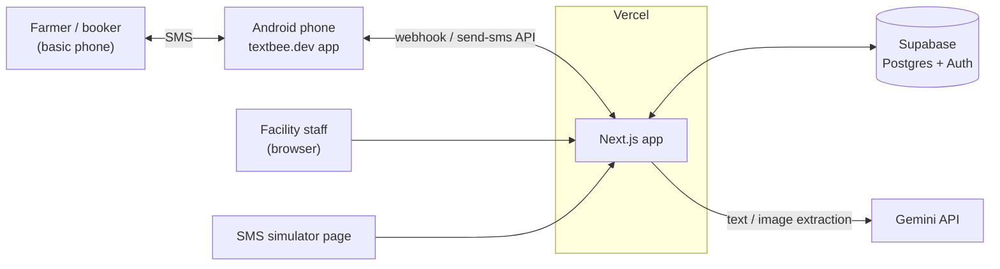
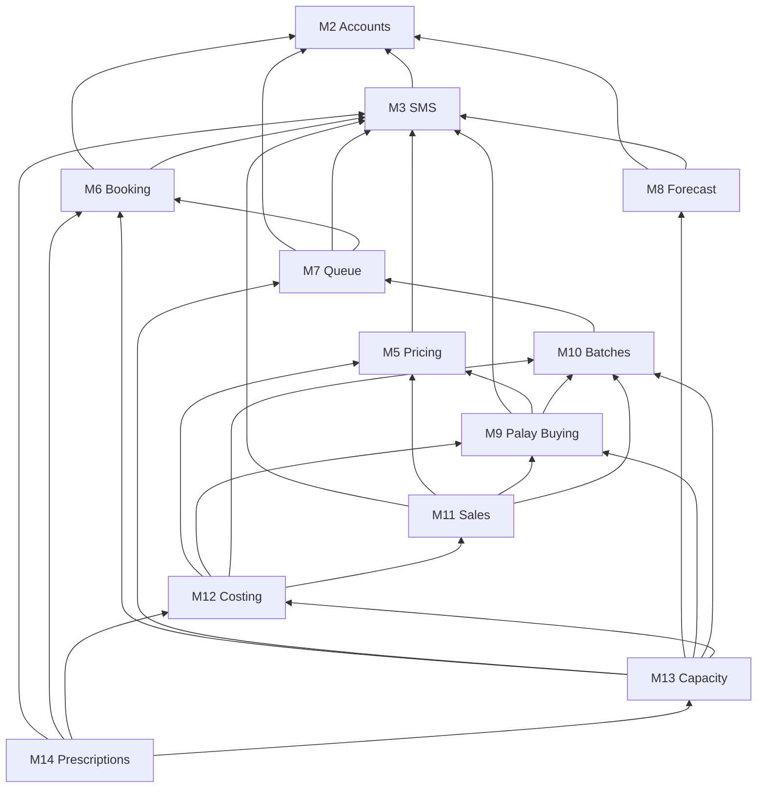
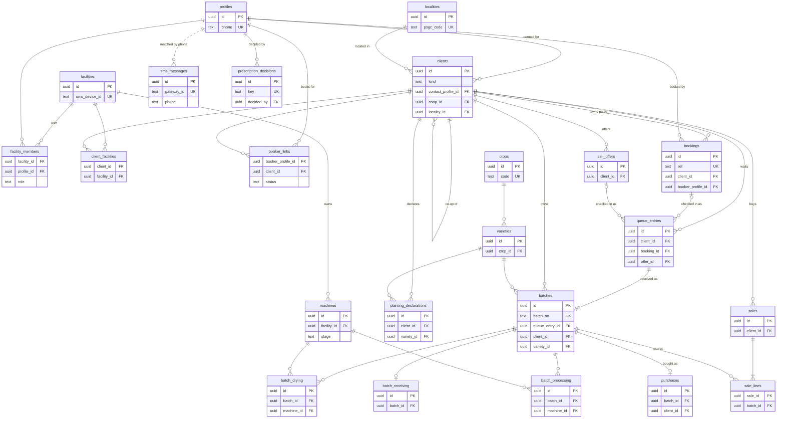
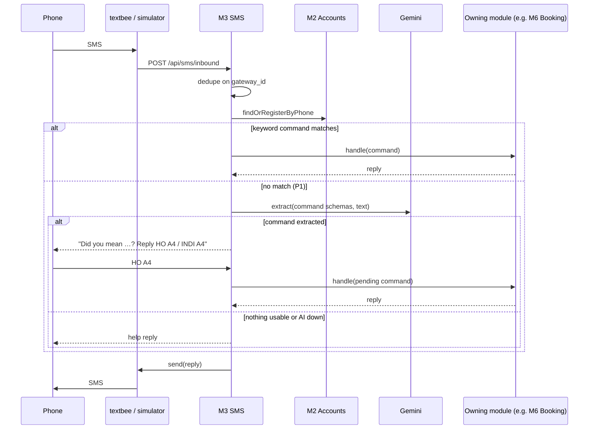
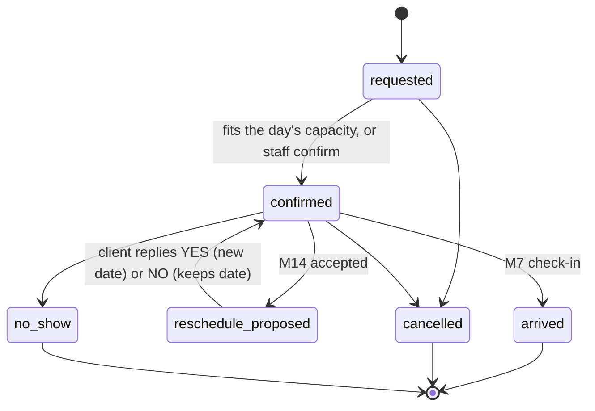
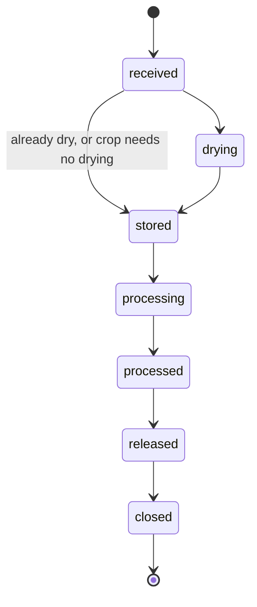

# TRD: Post-Harvest Facility Capacity Planning Platform

## Summary

The [PRD](PRD.md) says what we're building. This doc says how. Module numbers (M1 to M14) match the PRD.

The short version:

- One Next.js app on Vercel, with Supabase for the database and logins. Everything is on free tiers.
- The code is split by module. Each module has its own folder with its screens, logic, data access, SMS commands and tests.
- Farmers use SMS. The demo runs on a built-in phone simulator. A real phone running textbee.dev is the upgrade.
- AI (Gemini) only turns messy texts and form photos into structured data, and a person always confirms the result.
- The harvest forecast is trained offline in Python. The app only reads the numbers it produces.
- Nothing about IRPC or rice is in the code. It all lives in data, so other facilities, crops and regions can be added later.

## Stack

| Part              | We use                                                                            | Why                                                                 |
| ----------------- | --------------------------------------------------------------------------------- | ------------------------------------------------------------------- |
| App               | Next.js (App Router), TypeScript in strict mode, server actions                   | One app serves the screens and the SMS webhook. Most of us know it. |
| UI                | Tailwind CSS, shadcn/ui, shadcn charts                                            | Matches our design system.                                          |
| Database, logins  | Supabase: Postgres, Auth, Row Level Security (RLS)                                | Free, hosted, and handles logins and per-row access rules.          |
| Database access   | supabase-js, types from `supabase gen types`, SQL migrations via the Supabase CLI | No ORM. Queries run as the logged-in user, so RLS applies.          |
| Validation        | Zod                                                                               | One schema per form, SMS command and AI result.                     |
| Translations      | next-intl, one file per language (`en`, `hil` for now)                            | Also works outside React, for SMS texts and keywords.               |
| SMS               | textbee.dev on an Android phone with a SIM, plus a web simulator                  | Free tier, receives texts through a webhook, no sender-ID approval. |
| AI                | Vercel AI SDK with `@ai-sdk/google` (Gemini Flash, free tier)                     | Returns structured data that matches a Zod schema.                  |
| Hosting           | Vercel Hobby, Supabase in `ap-southeast-1` (Singapore)                            | Free, and the closest region to the Philippines.                    |
| Forecast training | Python (pandas, openpyxl, SciPy), run on a laptop                                 | Trains the M8 model. The app only reads the exported numbers.       |
| Tooling           | pnpm, Vitest, ESLint, Prettier, commitlint                                        | See [Testing and CI](#testing-and-ci).                              |

Start the repo with `create-next-app` and `shadcn init`, then pin exact versions.

## How the pieces connect



Farmers text a phone running the textbee app. textbee forwards each text to our app, and our replies go back the same way. In the demo, the simulator page stands in for the phones. Staff use the app in a browser. The app stores everything in Supabase and only calls Gemini to read messy texts and form photos.

## Code layout

```
src/
  app/                    pages and API routes only; they call into modules
  modules/
    facility-setup/       M1
    accounts/             M2
    sms/                  M3
    language/             M4
    pricing/              M5
    booking/              M6
    queue/                M7
    harvest-forecast/     M8
    palay-buying/         M9
    batches/              M10
    sales/                M11
    batch-costing/        M12
    capacity/             M13
    prescriptions/        M14
  lib/                    shared plumbing only: Supabase client, SMS gateway, AI helper, UI kit
supabase/migrations/      one migration per module: <timestamp>_<module>.sql
data/forecast/            Python scripts that parse OPA data and train the M8 model
messages/<locale>.json    UI text, SMS templates and SMS keywords, grouped by module
```

Every module folder has the same files:

| File          | What goes in it                                                                          |
| ------------- | ---------------------------------------------------------------------------------------- |
| `index.ts`    | The functions other modules may call. Nothing else is imported from outside.             |
| `logic.ts`    | Pure functions: math and rules, with no database or framework calls. Tests target these. |
| `queries.ts`  | Database reads.                                                                          |
| `actions.ts`  | Server actions, which do the writes.                                                     |
| `sms.ts`      | The module's SMS commands and texts, if it has any.                                      |
| `components/` | The module's screens and widgets.                                                        |
| `*.test.ts`   | Tests, if the module has any.                                                            |

Modules call each other's `index.ts` functions directly. There's no event bus, queue or cron. For example, when staff check a client in at the gate, M7 calls M6's `markArrived`. When M7 starts serving someone, it texts the next clients in line.

Dependencies only point one way, so there are no cycles. When one screen action spans two modules that would otherwise need each other, the server action in `src/app` calls both in order. Saving the receiving form is the main case: the action calls M10's `saveReceiving`, then M9's `createPurchase` if IRPC is buying the palay. M10 never calls M9.

Who calls whom (M1 and M4 are left out because nearly everything uses them):



## Rules for all code

- **Every facility's data is separate.** Each settings and operations table has a `facility_id`. The prototype has one facility, IRPC. Adding another means adding rows. It needs no new code, schema or deploy.
- **No rice in the code.** Crop names, stage labels, grades, form fields, places, languages, buyer types and prices all come from tables or translation files. Code never mentions rice, IRPC, Iloilo or Hiligaynon. Seed data and translation files can.
- **Units.**
  - Weights are whole kilograms.
  - Money is whole centavos. The column suffix `_minor` means the currency's smallest unit, set by `facilities.currency`.
  - Moisture content (MC) is a percent, stored as `numeric(4,1)`.
- **Time.** Dates use the facility's time zone (Asia/Manila for IRPC). Columns are `date` or `timestamptz`.
- **Standard columns.** Every table has `id` (UUID), `created_at` and `updated_at`.
- **Access.** Every screen action and SMS command calls M2's `can()` before doing anything. RLS is on for every table as a second line of defense. M2 has the details.
- **Service role key.** Only the SMS webhook and the seed script use it. The webhook acts on behalf of the phone number that sent the text.

## Shared plumbing

### Logins

- **Staff** log in with email and password through Supabase Auth. The seed script creates their accounts, with email confirmation turned off.
- **Clients and bookers** don't log in. They're identified by phone number over SMS. Web login for them is P1, using a one-time code sent by SMS.

### SMS gateway (`lib`)

```ts
interface SmsGateway {
  send(to: string, body: string): Promise<{ id: string }>;
}
```

- **`SimulatorGateway`** only saves messages. The simulator page shows a phone screen per number, so the demo never depends on a mobile network. Only admins can open it, and it's switched off when `SMS_GATEWAY=textbee`, since it can send texts as any phone.
- **`TextbeeGateway`** sends through textbee's `send-sms` API. Incoming texts reach us through textbee's webhook at `POST /api/sms/inbound`.
- The `SMS_GATEWAY` environment variable picks one.
- Each facility has its own gateway phone (`facilities.sms_device_id`). An incoming text goes to the facility whose phone received it.
- If textbee delivers the same text twice, we process it once. We dedupe on textbee's message ID.

### AI helper (`lib`)

- One function, `extract(schema, input)`, sends text or an image to Gemini and gets back data matching a Zod schema.
- A person always confirms AI output before anything is saved.
- If Gemini fails or hits its rate limit, the app falls back to the non-AI path: a help text, or an empty form.

### Translations (`lib`)

- Keys look like `<module>.<key>`, e.g. `booking.confirmed`.
- Crop-specific words come from keys stored on the crop. For example, `crops.rice.processing` is "Milling" in English.
- SMS keywords live in the translation files too, so a new language brings its own keywords.
- SMS texts use the same files through next-intl's `createTranslator`.
- SMS templates stick to plain GSM-7 characters. One text holds 160 characters, and no template may run past two texts.

## Data model

This diagram shows only keys and links. Each module section lists its full columns.

- Every settings and operations table has a `facility_id`. Only the main links to `facilities` are drawn.
- `crops`, `varieties`, `localities`, `profiles` and `clients` are shared by all facilities.
- `prices`, `catchment_shares`, `regional_crop_stats`, `forecast_params` and `orders` aren't drawn. They link to `facilities`, `crops`, `localities` or `clients`.



## Modules

Each section covers only the technical side. The PRD lists the features.

### M1. Facility Setup

**Tables**

| Table        | Columns                                                                                                                                                                                                                                                                                                                                                    |
| ------------ | ---------------------------------------------------------------------------------------------------------------------------------------------------------------------------------------------------------------------------------------------------------------------------------------------------------------------------------------------------------- |
| `facilities` | `name`, `locality_id`, `timezone`, `currency`, `default_locale`, `sms_device_id`, `storage_capacity_kg`, `operating_hours_per_day`, `base_load_kw`, `tariff_minor_per_kwh`, `labor_minor_per_hour`, `shrink_factor`, `idle_threshold_pct`, `forecast_window_days`, `forecast_range_pct`, `notify_ahead_n`, `buyer_types` (jsonb), `doc_ref_fields` (jsonb) |
| `machines`   | `facility_id`, `stage` (`drying` or `processing`), `code`, `capacity_kg` (per load, dryers only), `cycle_hours`, `kg_per_hour` (processing only), `rated_kw`, `active`                                                                                                                                                                                     |
| `crops`      | `code`, `name_key`, `requires_drying`, `target_final_mc`, `processing_label_key`, `output_types` (jsonb: main output, grades, by-products)                                                                                                                                                                                                                 |
| `varieties`  | `crop_id`, `code`, `name`, `maturity_days`, `default_yield_kg_per_ha`                                                                                                                                                                                                                                                                                      |
| `localities` | `psgc_code`, `name`, `level` (region, province, municipality or barangay), `parent_id`, `lat`, `lng`                                                                                                                                                                                                                                                       |

A few `facilities` columns need explaining:

| Column               | Meaning                                                                         |
| -------------------- | ------------------------------------------------------------------------------- |
| `base_load_kw`       | Power the plant draws on any working day, however little it processes           |
| `shrink_factor`      | Extra weight lost in drying beyond the water, from handling and cleaning        |
| `idle_threshold_pct` | Load below this share of capacity counts as idle                                |
| `notify_ahead_n`     | How many clients in line get the "your turn is near" text                       |
| `doc_ref_fields`     | The paper-form numbers this facility records, e.g. WTS no. and WSR no. for IRPC |

**Functions for other modules:** `getFacility(id)`, `dryingCapacityKgPerDay(facility, machines)`, `processingCapacityKgPerDay(facility, machines)`.

**How capacity is worked out**

- Drying per day = for each active dryer, `capacity_kg` × how many full cycles fit in a working day (`operating_hours_per_day` ÷ `cycle_hours`, rounded down). Add them up.
- Processing per day = for each active processing machine, `kg_per_hour` × `operating_hours_per_day`. Add them up.
- Crops with `requires_drying = false` skip the dryers.

**Seed data** (`pnpm seed`)

- PSGC places for Western Visayas.
- Rice, with its varieties, MC target, "milling" label, grades (WMR, dasdas, brown rice) and by-products (bran, brewer, broken).
- IRPC as a facility:
  - Dryers from the spec sheet: 5 × 10 t + 1 × 6 t. The 40 t alternative sits in a comment.
  - One mill.
  - Its paper-form numbers (WTS no., WSR no.) and its buyer types.
- Staff accounts.
- About 30 farmers in 3 Pototan co-ops, with their booker links approved.
- A few traders and stores as buyers and custom-milling clients.
- Buyers modelled on IRPC's anonymized top-20 client list.
- Today's prices, a few accepted sell offers, and a queue in progress.
- A peak-season scenario with at least one overloaded day and one idle stretch.

### M2. Accounts and Access

M2 keeps two kinds of records apart:

- **Profiles** are people with a phone number: farmers, bookers, staff. They send texts and log in.
- **Clients** are who IRPC does business with: a farmer, co-op, trader, store or institution. Clients own palay and buy rice. Each client has a contact profile. For a farmer, the client and the profile are the same person.

**Tables**

| Table               | Columns                                                                                                                                                                                                                       |
| ------------------- | ----------------------------------------------------------------------------------------------------------------------------------------------------------------------------------------------------------------------------- |
| `profiles`          | `auth_user_id` (empty unless the person logs in), `name`, `phone` (international format, unique), `locale`, `locality_id` (barangay), `registry_ids` (jsonb, e.g. RSBSA no.)                                                  |
| `clients`           | `kind` (`farmer`, `coop`, `trader`, `store`, `institution`), `name`, `contact_profile_id`, `locality_id`, `coop_id` (a `coop` client, for farmers), `buyer_type` (one of a facility's `buyer_types`, if the client buys rice) |
| `client_facilities` | `client_id`, `facility_id`, `first_seen_at`. Written the first time a client books, checks in, sells or buys at a facility.                                                                                                   |
| `facility_members`  | `facility_id`, `profile_id`, `role` (`encoder`, `manager` or `admin`)                                                                                                                                                         |
| `booker_links`      | `booker_profile_id`, `client_id`, `status` (`pending` or `approved`), `created_by` (`sms` or `staff`)                                                                                                                         |

**Functions for other modules:** `findOrRegisterByPhone(phone)`, `resolveClient(sender, forPhone?)`, `can(actor, action, resource)`.

**`resolveClient`** handles texts that end in `FOR <phone>`, meaning "I'm acting for this client".

- If a link exists and is approved, it returns that client.
- If not, it creates a `pending` link and texts the client's contact a prompt to approve it (P1). Until they reply `HO <code>`, the command is held.
- At P0, links are approved automatically, and the demo seed creates them.
- Links that staff create in person are approved straight away.

**`can(actor, action, resource)`** is one pure function in `logic.ts` that encodes the PRD's "who can do what" table. Every server action and every SMS handler calls it before doing anything.

- **Actors:**
  - a staff member, with their role at that facility
  - an SMS sender, with the clients they're linked to
- **Actions** are named strings, such as `booking.create`, `booking.cancel`, `queue.checkIn`, `batch.record`, `price.set`, `purchase.override`, `sale.record`, `cost.view`, `prescription.decide`, `facility.configure` and `simulator.use`.
- On a refusal, SMS handlers reply with the `accounts.notAllowed` text, and server actions throw.

**Database rules (RLS).** These back up `can()` for reads, so a bug in a screen can't leak data.

- Staff can read and write operations rows for facilities in their `facility_members`.
- Staff can read a client only if `client_facilities` links that client to one of their facilities (P1; at P0, any staff member can read all clients).
- Only managers and admins can read cost views. Only admins can write settings.
- A logged-in client (P1 web) can read rows where they own the palay, are the booker, or are linked through an approved `booker_links` row.
- SMS handlers run with the service role key, which skips RLS. That's why every handler must call `can()` first.

**Tests:** `can()` cases for each row of the permission table, including a stranger trying to cancel someone else's booking.

### M3. SMS

**Tables**

- `sms_messages` with `direction`, `phone`, `body`, `gateway_id` (unique), `parsed` (jsonb), `via_ai`, `status`.
- `sms_prompts` with `phone`, `code` (2 characters), `kind` (`ai_confirm`, `link_approval`, `reschedule`), `payload` (jsonb), `expires_at`, `status`. One row for every text that asks a yes/no question.

**Yes/no replies.** Every question the app texts ends with its code, e.g. "Reply HO A4 or INDI A4", so a reply with a code is never ambiguous. A bare `HO`, `YES`, `INDI` or `NO` with no code is resolved like this:

1. If the phone has exactly one open prompt, the reply answers it.
2. If it has several, the app asks which one, listing each code with a few words about it.
3. If it has none, the reply gets the help text.

Prompts expire after 24 hours. A booking's own reference code (`YES K7P2QX`) also works for reschedule prompts.

**Functions for other modules:** `registerCommand({ keywords, schema, parse, handle })`, `sendTemplate(profile, key, vars)`.

**What happens to an incoming text**



In words:

1. Find or register the sender by phone number.
2. Try each module's keyword command. The first one that matches handles the text, after checking `can()`.
3. If none match, ask Gemini to turn the text into one of the known commands (P1). Reply "Did you mean …?" with a prompt code, and wait for `HO <code>` before doing anything.
4. If that fails too, send a help text.

**Tests:** keyword parsing.

### M4. Language

**Function for other modules:** `t(profile, key, vars)` returns an SMS text in the person's language. If the person has no language set, it uses the facility's default.

Web screens get their language from a cookie or the logged-in profile, through next-intl.

The available languages are whatever files exist in `messages/`. Adding one is adding a file.

A native Hiligaynon speaker on the team must check all Hiligaynon text and keywords.

### M5. Pricing

**Table:** `prices`, one row per facility, crop and date. Rows are only ever added, never edited, so old prices stay on record.

| Column                                     | Meaning                                                                                                             |
| ------------------------------------------ | ------------------------------------------------------------------------------------------------------------------- |
| `facility_id`, `crop_id`, `effective_date` | Which facility, crop and day the prices apply to                                                                    |
| `buy_base_minor_per_kg`                    | Palay buying price at the reference MC                                                                              |
| `buy_reference_mc`                         | The MC the base price assumes (25% for IRPC)                                                                        |
| `buy_rules` (jsonb)                        | Deduction factors, e.g. `{ damaged: 0.25, immature: 0.10, foreign: 1.0, sack_kg: 0.1 }`, and the MC adjustment rule |
| `drying_fee_minor_per_kg`                  | Drying fee, per wet kilo                                                                                            |
| `processing_fee_minor_per_kg`              | Milling fee, per kilo of rice out                                                                                   |
| `sell_minor_per_kg` (jsonb)                | Selling price per output grade, e.g. `{ WMR: 4700 }`                                                                |

**Function for other modules:** `priceOn(facilityId, cropId, date)`.

Keeping every price by date is P0, because M12 costs each batch at the prices of its own dates. Only the price history screen is P1.

**SMS commands:** `PRICE` / `PRESYO`, `RATES` / `BAYAD`.

### M6. Booking

**Table:** `bookings` with:

- `facility_id`, `crop_id`
- `ref`, a 6-character code that clients use in texts
- `type`: `drying` or `processing`
- `client_id` (who owns the palay), `booker_profile_id` (who made the booking)
- `channel`: `sms`, `staff` or `web`
- `est_kg`, `preferred_date`, `flex_days` (how many days either way the client can move), `scheduled_date`
- `status`

**Functions for other modules:** `bookingsBetween(from, to)`, `findByRef(ref)`, `proposeReschedule(bookingId, date)`, `markArrived(bookingId)`.

**When a booking is confirmed.** A new booking is confirmed straight away if that day's confirmed bookings plus this one fit within the dryer or mill capacity from M1. M6 checks this with its own bookings only, so it doesn't depend on M13. If it doesn't fit, the booking stays `requested`. The client gets a "request received, we'll confirm or suggest a date" text, and staff confirm it or propose another date.

**Allowed status changes.** `logic.ts` rejects anything else.



**SMS commands**

| Command | Format                                               | Example (rice)           |
| ------- | ---------------------------------------------------- | ------------------------ |
| Book    | `BOOK DRY\|<processing word> <kg> <dd/mm> [±<days>]` | `BOOK DRY 5000 20/10 ±3` |
| Answer  | `YES <ref>` or `NO <ref>`                            | `YES K7P2QX`             |
| Cancel  | `CANCEL <ref>`                                       | `CANCEL K7P2QX`          |

- Book accepts `FOR <phone>` at the end, to book for someone else.
- Hiligaynon aliases: `RESERBA` (book), `HO` / `INDI` (yes / no).
- The processing word comes from the crop's translation entry: `MILL` / `GALING` for rice.
- Every command calls `can()`. Only the client's contact or an approved booker can answer or cancel.

### M7. Queue

**Table:** `queue_entries` with `facility_id`, `service` (`drying`, `processing` or `selling`), `client_id`, `booking_id` (empty for walk-ins), `offer_id` (for palay sold to IRPC), `checked_in_at`, `started_at`, `finished_at`, `status` (`waiting`, `serving`, `done` or `left`), `position`.

**Functions for other modules:** `checkIn({ bookingRef | phone | walkIn })`, `start(entryId)`, `finish(entryId)`, `lineFor(service)`.

**How it works**

- `checkIn` creates an entry at the end of that service's line. If it has a booking, it calls M6's `markArrived`.
- `start` marks the entry as being served, then texts the next `notify_ahead_n` waiting clients that their turn is near. M10 opens the receiving form from a started entry, so the batch knows its client, booking or offer.
- `finish` closes the entry.
- The order is first come, first served. Booked clients don't jump the line in P0; that rule is a setting for later.
- The live queue screen refreshes through Supabase Realtime, or by polling every few seconds if that's simpler.

**SMS command:** `STATUS` replies with the sender's place in each line they're in (P1).

**Tests:** line order, and the "turn is near" texts going to the right clients.

### M8. Harvest Forecast

M8 answers one question: how many kilos should reach this facility on each upcoming day? It has two sources.

1. **Declared plantings.** A farmer tells us what they planted, and we work out when it'll be ready.
2. **The forecast model.** For everyone who hasn't told us, we use municipal planting reports and a model trained on last year's real data.

**Tables**

| Table                   | Columns                                                                                                                                                             |
| ----------------------- | ------------------------------------------------------------------------------------------------------------------------------------------------------------------- |
| `planting_declarations` | `client_id`, `booker_profile_id`, `locality_id`, `area_ha` (`numeric(6,2)`), `variety_id`, `planted_on`                                                             |
| `regional_crop_stats`   | `locality_id`, `crop_id`, `period_start`, `period_end`, `kind` (`planted` or `harvested`), `area_ha`, `production_kg`, `source` (e.g. `opa-2025`, `demo-synthetic`) |
| `forecast_params`       | `crop_id`, `locality_id` (empty = province-wide), `lag_weights` (jsonb), `yield_kg_per_ha`, `residual_p10`, `residual_p90`, `trained_on`, `metrics` (jsonb)         |
| `catchment_shares`      | `facility_id`, `crop_id`, `locality_id`, `share`                                                                                                                    |

`regional_crop_stats` and `forecast_params` describe a region, not a facility, so every facility in that region shares them.

**Function for other modules:** `expectedArrivals(facilityId, from, to)` returns kilos per day for each source (`declared` and `forecast`), each with a low and a high value.

**Declared plantings**

- Expected harvest date = planting date + the variety's `maturity_days`.
- The harvest window is that date ± `forecast_window_days`.
- Kilos = hectares × the variety's yield, ± `forecast_range_pct`.
- The kilos are spread over the window, with most of them in the middle.

**Forecast model**

The idea: what a municipality plants now, it harvests about 100 days later. The model learns from real 2025 data how planted hectares turn into harvested tonnes, and how long that takes.

- Harvest in a municipality for a half-month = a weighted sum of what it planted 5, 6, 7, 8 and 9 half-months earlier, × that municipality's yield per hectare. The weights come from training and say how much of each earlier planting gets harvested now.
- Arrivals at the facility = that harvest × the facility's usual share of the municipality (`catchment_shares`).
- Each half-month's kilos are spread evenly across its days.
- The low–high range comes from the model's real errors on data it didn't train on: the 10th and 90th percentiles.

When a municipality lacks good data, the model falls back in this order:

1. The municipality's own trained numbers.
2. The province-wide numbers, for the three municipalities with bad data.
3. Last year's harvest × share, if there's no planting report for that period at all.

**SMS command:** `PLANT <ha> <variety> <dd/mm>` / `TANOM …`, with optional `FOR <phone>`.

**Loading data**

- `pnpm import:stats <file.csv>` loads planting and harvest reports. Every region uses the same columns: `psgc_code, crop, period_start, period_end, kind, area_ha, production_kg, source`. A new data source needs a small converter script that writes this format.
- `pnpm import:model <params.json>` loads the trained model numbers.
- Each `catchment_shares` value = IRPC's 2021–2023 purchases from a municipality ÷ that municipality's yearly harvest.

**Training** (`data/forecast/`, Python, run by hand)

1. **Parse** the OPA spreadsheet. It has traps, listed in [Appendix: OPA spreadsheet notes](#appendix-opa-spreadsheet-notes).
2. **Fit**:
   - The lag weights are fitted across all municipalities together, with non-negative least squares, so no weight comes out negative.
   - Yield per municipality = tonnes harvested ÷ hectares harvested.
   - Batad, Maasin and San Dionisio harvested less than 70% of what they planted, so their data is suspect. They use the province-wide numbers.
3. **Test** by holding out one municipality at a time, training on the rest, and checking how well the model predicts the one held out. Save the scores in `metrics`.
4. **Export** `params.json`, plus a CSV of the cleaned data for `import:stats`.

What the first trial run found:

| Result                                   | Value                                 |
| ---------------------------------------- | ------------------------------------- |
| Weights for lags 5 to 9 half-months      | about 0.15, 0.41, 0.31, 0.09, 0.03    |
| Typical time from planting to harvest    | about 100 days                        |
| Accuracy for the whole province          | R² ≈ 0.91 (good)                      |
| Accuracy per municipality per half-month | R² ≈ 0.5 (noisy)                      |
| Warning time it gives                    | about 80 days after a planting report |

**Demo data.** There's no real 2026 planting report yet. A script makes one from the 2025 planting data, shifting each municipality by up to one half-month and scaling it by up to ±15%. It's saved with `source = 'demo-synthetic'`, and the capacity page labels it as demo data. It's never used for training or testing the model.

**Tests:** the model applied with fixed numbers, the fallback order, and the declared-planting window math.

### M9. Palay Buying

**Tables**

| Table         | Columns                                                                                                                                                                                                                      |
| ------------- | ---------------------------------------------------------------------------------------------------------------------------------------------------------------------------------------------------------------------------- |
| `sell_offers` | `facility_id`, `crop_id`, `client_id`, `booker_profile_id`, `variety_id`, `est_kg`, `harvest_date`, `status` (`offered`, `accepted`, `declined`, `arrived`, `withdrawn`)                                                     |
| `purchases`   | `facility_id`, `batch_id`, `client_id`, `price_date`, `net_kg`, `paid_kg` (after deductions), `price_minor_per_kg`, `total_minor`, `deductions` (jsonb, kilos per reason), `override_reason`, `overridden_by`, `voucher_ref` |

**Functions for other modules:** `quote(facilityId, cropId, mc, kg?)`, `priceFromReceiving(receiving, prices)`, `createPurchase(batchId)`, `acceptedOffersBetween(from, to)`, `purchaseCost(batchId)`.

**How the price is worked out** (pure functions in `logic.ts`, following the paper Receiving Report)

1. Start from the day's `buy_base_minor_per_kg`, which assumes the palay is at `buy_reference_mc`.
2. Adjust for MC with the rule in `buy_rules`. The default rule pays for dry matter: price × (100 − actual MC) ÷ (100 − reference MC). IRPC hasn't confirmed this, so it's a setting.
3. Take off weight for quality: damaged kilos × 0.25, immature kilos × 0.10, foreign matter kilos × 1.0, and sacks at `sack_kg` each. The factors come from `buy_rules`.
4. Total = paid kilos × adjusted price per kilo.

A quote runs steps 1, 2 and 4 with no quality deductions, so the reply says "estimate".

`createPurchase(batchId)` reads the batch's receiving record from M10, runs `priceFromReceiving`, and saves the `purchases` row. The receiving page's server action calls it right after M10 saves the form, for palay that IRPC is buying. The encoder sees the price, and the client gets a text.

**SMS commands**

| Command | Format                                      | Example                 |
| ------- | ------------------------------------------- | ----------------------- |
| Quote   | `QUOTE <mc>% [<kg>]` / `PRESYO KO …`        | `QUOTE 23% 5000`        |
| Sell    | `SELL <kg> <variety> <dd/mm>` / `BALIGYA …` | `SELL 3000 RC222 25/10` |

`SELL` accepts `FOR <phone>`. Accepted offers feed M13 as expected arrivals.

**Tests:** the price math against IRPC's sample procurement forms (8,763 kg at ₱21/kg = ₱184,023), MC above and below the reference, and each deduction.

### M10. Batch Records

**Tables**

| Table              | Columns                                                                                                                                                                   |
| ------------------ | ------------------------------------------------------------------------------------------------------------------------------------------------------------------------- |
| `batches`          | `facility_id`, `batch_no`, `queue_entry_id`, `booking_id` or `offer_id` (optional), `client_id`, `ownership` (`custom` or `facility`), `stage`, `variety_id`, `closed_at` |
| `batch_receiving`  | `batch_id`, `doc_refs` (jsonb, using the facility's `doc_ref_fields`), `bags`, `gross_kg`, `net_kg`, `mc`, `damaged_pct`, `immature_pct`, `foreign_pct`                   |
| `batch_drying`     | `batch_id`, `machine_id`, `mc_in`, `mc_out`, `started_at`, `ended_at`, `dried_kg`, `bags_out`                                                                             |
| `batch_processing` | `batch_id`, `machine_id`, `input_kg`, `started_at`, `ended_at`, `outputs` (jsonb: kilos per output type)                                                                  |

**Functions for other modules:** `saveReceiving(queueEntryId, form)`, `storageStockOn(date)`, `milledStock(facilityId)`, `batchWithStages(id)`, `scheduledProcessing(from, to)`, `markReleased(batchId)`.

- The receiving form opens from a started M7 queue entry. Saving it creates the batch. The pricing step for bought palay happens in M9 (see the dependency rule under Code layout).

**Stages** only move forward. Drying is skipped for processing-only bookings and for crops that don't need drying. A batch is `released` once all its milled output has left storage, whether the client picked it up or M11 sold it. The `stage` values are `received`, `drying`, `stored`, `processing`, `processed`, `released` and `closed`. Screens show the crop's labels, so for rice `processing` reads "Milling" and `processed` reads "Milled", matching the PRD.



**Math**

- Expected dried weight = wet kilos × (100 − MC before) ÷ (100 − MC after) × `shrink_factor`. The batch stores the actual dried weight once it's known.
  - Example from IRPC's sample form: 11,704 kg dried from 23% to 13.5% (the form's recorded final MC) works out to 11,704 × 77 ÷ 86.5 = 10,419 kg before shrink. The form records 9,295 kg. That gap is what `shrink_factor` covers. (With a 14% target instead, it would be 10,479 kg.)
- Recovery = main output kilos ÷ input kilos. The crop's `output_types` says which output is the main one.

**Photo to form (P1).** The encoder uploads a photo of a paper form. `extract` reads it into the stage form's Zod schema. The form opens filled in, and the encoder checks and saves it. Photos aren't kept.

**Tests:** shrink and recovery math, and the stage rules.

### M11. Sales and Dispatch

**Tables**

| Table         | Columns                                                                                                                                 |
| ------------- | --------------------------------------------------------------------------------------------------------------------------------------- |
| `sales`       | `facility_id`, `client_id` (the buyer), `sold_at`, `grade`, `qty_kg`, `unit_price_minor`, `or_ref` (official receipt or invoice number) |
| `sale_lines`  | `sale_id`, `batch_id`, `qty_kg`. Which batches the rice in a sale came from.                                                            |
| `orders` (P1) | `facility_id`, `client_id`, `grade`, `qty_kg`, `pickup_date`, `status` (`reserved`, `ready`, `picked_up`, `cancelled`)                  |

A sale can draw from several batches, and a batch can go to several sales. `sale_lines` is what makes tracing work in both directions.

**Functions for other modules:** `availableStock(facilityId)`, `salesForBatch(batchId)`, `batchesForSale(saleId)`, `traceBatch(batchId)`.

`traceBatch` puts a batch's whole trail together: queue entry (M7, through the batch), stages (M10), purchase (M9) and sales. It lives here because M11 is the most downstream module that holds trail data, so it can read all the others without a cycle.

**How it works**

- A sale is for one grade (`sales.grade`). Its `sale_lines` draw that grade from each batch, so a batch's remaining kilos of a grade = its `outputs[grade]` − the `sale_lines` kilos of sales with that grade.
- Available stock per grade = the sum of that across batches − kilos reserved by open orders.
- When a sale is recorded, `logic.ts` picks source batches oldest first, among batches that still have that grade. Staff can change the pick before saving.
- When a batch has nothing left in storage, M11 calls M10's `markReleased`.
- An order marked `ready` texts the buyer (P1).

**Tests:** oldest-first picking per grade, and stock never going below zero.

### M12. Batch Costing

No tables. M12 calculates costs on the fly from M10's stage records, M1's settings, M5's prices, M9's purchases and M11's sales.

**Function for other modules:** `batchCost(batchId)` returns cost, revenue, margin, and margin per kilo of input and per kilo of main output.

It loads the batch's stages, plus every other stage at the same facility that overlaps them in time, and passes both to the pure function `costFromStages(stages, overlappingStages, facility, prices)` in `logic.ts`. The overlapping stages are what make the base-load split possible.

**Math**

- Electricity:
  - Each stage's hours × that machine's `rated_kw` × `tariff_minor_per_kwh`.
  - Plus the plant's `base_load_kw` for the same hours × the same tariff. When stages of different batches overlap in time, each hour of base load is split evenly among the stages running in that hour.
- Labor = stage hours × `labor_minor_per_hour`.
- Revenue:
  - Custom service: drying and milling fees at the prices in effect on each stage's date.
  - IRPC-owned: the batch's `sale_lines` value from M11 − its purchase cost from M9.

**Tests:** IRPC's sample forms: the drying batch (11,704 kg in) and the milling run (9,295 kg in, 3 hours).

### M13. Capacity

No tables. It only reads from other modules. All views on the page share one data function, so they can't disagree.

**Function for other modules:** `capacityByDay(facilityId, from, to)` returns, for each day and each pool (`drying`, `storage`, `processing`):

- expected load by source (`confirmed`, `offer`, `declared`, `forecast`), each low and high
- capacity
- an `overloaded` flag
- an `idle` flag

**Math** (pure functions over M6 bookings, M8 arrivals, M9 accepted sell offers, M10 stock and planned processing, and M1 capacity)

- Storage today = storage yesterday + what went in − what went to processing. For crops that skip drying, received palay goes straight into storage. Anything above `storage_capacity_kg` shows as overflow.
- A day is **overloaded** when confirmed + offer + declared load is above capacity. The forecast alone doesn't trigger it.
- A day is **idle** when even the high estimate is below `idle_threshold_pct` of capacity.
- It's recalculated on every page load, with no cache and no cron.

**Views** (tabs on one page, `src/app/capacity`)

| View     | Built from                                                                                    | Chart                                                |
| -------- | --------------------------------------------------------------------------------------------- | ---------------------------------------------------- |
| Headline | `capacityByDay` totals, M12 electricity per kilo                                              | Number tiles                                         |
| Chart    | `capacityByDay`                                                                               | Stacked bars or areas, capacity line (shadcn charts) |
| Days     | `capacityByDay`                                                                               | Table grid                                           |
| Season   | `capacityByMonth`: past months from M10 batch stage times, future months from `capacityByDay` | Heatmap (a grid of colored cells)                    |
| Map      | M8 `expectedArrivals` per municipality, `localities.lat` / `lng`                              | Bubble map (Leaflet with OpenStreetMap tiles, free)  |
| Today    | M7 queue entries, M10 stage start and end times                                               | Timeline per machine                                 |
| Flow     | `capacityByDay` summed over a week                                                            | Four boxes with arrows                               |

- The map needs a centre point per municipality. PSGC has no coordinates, so `localities` gets `lat` and `lng`, filled from OpenStreetMap for the region we seed.
- The day breakdown panel is one shared component that every view opens.

**Tests:** overflow and idle detection, and the monthly rollup.

### M14. Prescriptions

**Table:** `prescription_decisions` with `kind`, `key` (a hash of the suggestion's inputs), `status` (`accepted` or `dismissed`), `decided_by`. Suggestions are recalculated from `capacityByDay()` every time; only the manager's decisions are saved.

**The rules** (one pure function each)

- **Move bookings off a busy day.**
  1. For each overloaded drying day, take its flexible bookings, biggest first.
  2. Move each to the nearest day within its `flex_days` that has room.
  3. Stop when the overflow is gone or nothing else can move. Report what's left.

  Accepting a move calls M6's `proposeReschedule`, which texts the client.

- **Process in full loads** (milling, for rice):
  - With S kilos in storage and H days to work with, compare two plans: running full days (S ÷ daily capacity, rounded up) against spreading S over all H days.
  - Electricity per plan = machine kW × hours run + `base_load_kw` × `operating_hours_per_day` × days run.
  - Return the suggested dates, the cost per kilo of each plan, and the saving.
- **Store now, process later.** Send overflow from busy processing days to storage, then fill the nearest idle processing days that storage can supply.
- **Fill idle days.** For an idle stretch, list farmers and co-ops with no open booking, biggest past volume first, and draft a text with current rates and buying prices.
- **Plain-language summary (P2).** Gemini gets only the calculated numbers and writes one or two sentences. The numbers are shown next to its text.

**Tests:** a 30 t overflow with three flexible bookings, and full-load against spread-out cost per kilo.

## Adding a facility, crop, region or language

| To add     | Steps                                                                                                                      | Code change                              |
| ---------- | -------------------------------------------------------------------------------------------------------------------------- | ---------------------------------------- |
| A facility | Add rows to `facilities`, `machines`, `prices` and `facility_members`. Set up a gateway phone.                             | None                                     |
| A crop     | Add rows to `crops` and `varieties`. Add its labels and keywords to each translation file.                                 | None                                     |
| A region   | Load its PSGC places. Convert its planting and harvest reports to the standard CSV, import them, and retrain the forecast. | A converter, if the source format is new |
| A language | Add `messages/<locale>.json` with screens, SMS texts and keywords.                                                         | None                                     |

How it scales:

- **One app, many facilities.** All facilities share one database, kept apart by `facility_id` and RLS. Indexes start with `facility_id`.
- **The work per page stays small.** The capacity page and suggestions only look at one facility's next few weeks. Load grows with the number of facilities, not with years of history. If pages get slow, move `capacityByDay()` into a Postgres function or cache it per facility.
- **A provincial view later** is just a query across facilities. It needs no schema change.
- **The limit.** The stage model is receive → dry (optional) → store → process → dispatch. It fits rice, corn, coffee, cacao and copra. Cold-chain produce would need new stage types.

## Testing and CI

- **Tests.** A handful of Vitest tests on the numbers the demo shows. Each module section lists its tests. We don't test UI, run end-to-end tests or track coverage.
- **CI.** GitHub Actions runs lint and typecheck on every PR. Vercel builds a preview for every PR.
- **Forecast training** isn't in CI. Re-run it by hand when new reports arrive, and commit the new `params.json` and `metrics`.

## Environment variables

| Name                                                        | Used by                                                       |
| ----------------------------------------------------------- | ------------------------------------------------------------- |
| `NEXT_PUBLIC_SUPABASE_URL`, `NEXT_PUBLIC_SUPABASE_ANON_KEY` | The app                                                       |
| `SUPABASE_SERVICE_ROLE_KEY`                                 | SMS webhook and seed script                                   |
| `SMS_GATEWAY`                                               | `simulator` or `textbee`                                      |
| `TEXTBEE_API_KEY`                                           | textbee gateway. Each facility's phone ID is in `facilities`. |
| `SMS_WEBHOOK_SECRET`                                        | Checking that incoming webhooks really come from textbee      |
| `GOOGLE_GENERATIVE_AI_API_KEY`                              | Gemini                                                        |

## Costs and free-tier limits

Everything is free except prepaid load for the gateway phone's SIM.

| Service          | Limit to know about                                                                 | What we do                                                                          |
| ---------------- | ----------------------------------------------------------------------------------- | ----------------------------------------------------------------------------------- |
| Supabase Free    | Pauses after 7 days without use. Its built-in email sends only a few per hour.      | Fine for the event. Staff accounts come from the seed, with no emails.              |
| Vercel Hobby     | Non-commercial use only. Cron runs at most once a day.                              | We don't use cron. A real pilot needs Vercel Pro or another host.                   |
| textbee.dev Free | 1 phone, 50 texts a day, 300 a month                                                | The demo uses the simulator. For more texts, switch to SMSGate, which is free.      |
| Gemini Free      | Limits per minute and per day. Google may use what we send to improve its products. | The non-AI fallback covers hitting the limits. A real pilot moves to the paid tier. |
| GitHub Actions   | Free for public repos. Private repos get 2,000 minutes a month.                     | CI only runs lint and typecheck.                                                    |

## Open questions

- **Machine power and base load.** IRPC hasn't confirmed them. The seed uses placeholders, and the cost screens label those figures as estimates.
- **Day-level dryer capacity.** We plan dryer capacity per day. Per-cycle slots might be needed later; day-level is enough for P0.

## Appendix: OPA spreadsheet notes

File: `data/opa/raw/ANNUAL REPORT PROVINCIAL DATA 2025.xlsx`. Row and column numbers start at 0.

**Planting sheet ("BY MUNICIPALITY (Planting)")**

- Each place is a 24-row block, one row per half-month. The place names are correct.
- Hectares planted are in column 74. Irrigated is column 17, rainfed column 59.

**Harvest sheet ("BY MUNICIPALITY (harvesting)")**

- The place names on data rows are shifted for 18 places. Pototan's real data is labelled "Pavia", for example.
- Each place's total row has the correct name. Find each total row and take the 24 rows above it.
- Hectares harvested are in column 72.
- For production, add columns 62, 65, 68 and 71. Column 74 has a wrong value for Zarraga, Jan 16 to 31.

**Checks**

- The places must add up to the provincial total.
- Planted against harvested hectares per place: anything outside 0.7 to 1.3 gets flagged. Batad, Maasin and San Dionisio fail this check.
