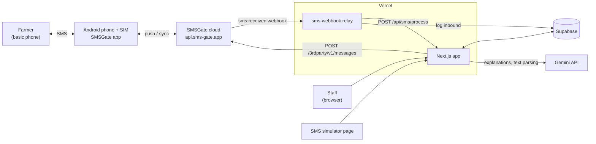
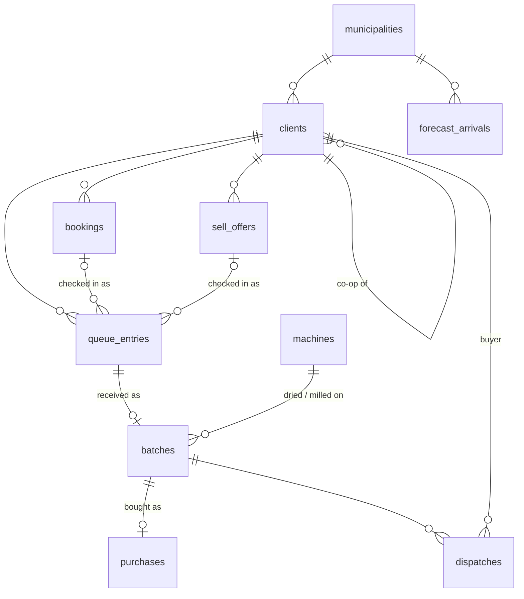
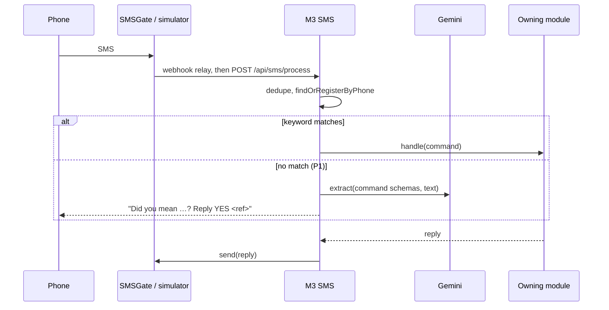
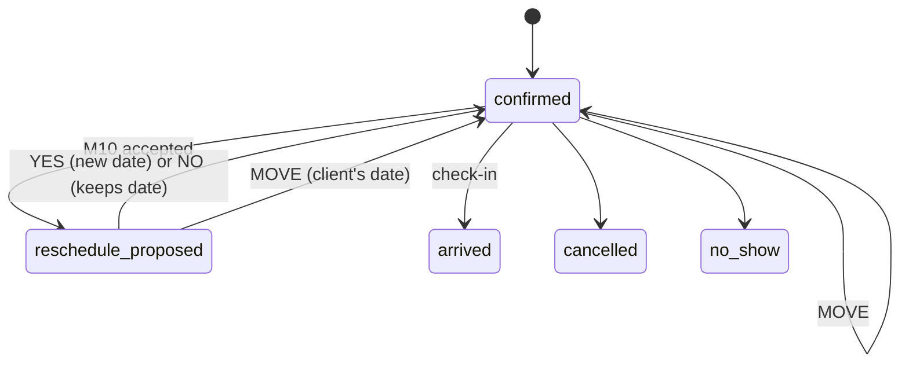

# TRD: Post-Harvest Facility Capacity Planning Platform

How we build the [PRD](PRD.md). Module numbers (M1–M10) match.

## Summary

- One Next.js app on Vercel, with Supabase for the database and auth. All free tiers.
- One folder per module.
- Clients use SMS through SMS Gateway for Android (SMSGate) on its cloud server, with a simulator for the demo.
- AI (Gemini) reads free-text SMS. It never computes numbers.
- The forecast is trained offline in Python. The app imports its output.
- Single facility (IRPC) and crop (rice). Operations tables keep a `facility_id` for later.

## Stack

| Part              | Choice                                                        |
| ----------------- | ------------------------------------------------------------- |
| App               | Next.js (App Router), strict TypeScript, server actions       |
| UI                | Tailwind, shadcn/ui, shadcn charts                            |
| Database, auth    | Supabase: Postgres, Auth                                      |
| Data access       | supabase-js, `supabase gen types`, Supabase CLI migrations    |
| Validation        | Zod, for forms, SMS commands and AI results                   |
| SMS               | SMSGate cloud, a webhook relay, plus a web simulator          |
| AI                | Vercel AI SDK with `@ai-sdk/google` (Gemini Flash, free tier) |
| Hosting           | Vercel Hobby, Supabase `ap-southeast-1`                       |
| Forecast training | Python (pandas, openpyxl, SciPy), offline                     |
| Tooling           | pnpm, Vitest, ESLint, Prettier, commitlint                    |

## System context



## Code layout

```
src/
  app/              pages and API routes
  modules/<name>/   one per module: logic.ts (pure, tested), queries.ts, actions.ts, sms.ts, components/
  lib/              Supabase client, SMS gateway, AI helper
supabase/migrations/
data/forecast/      Python: parse OPA data, train, export arrivals
services/sms-webhook/  Vercel project: SMSGate webhook relay
infra/sms-gateway/  Optional self-hosted SMSGate (Docker Compose + MariaDB)
```

Modules import each other directly. No event bus, queue or cron.

- `logic.ts` is pure and imports no other module.
- Cross-module calls live only in `actions.ts` and `queries.ts`, so cycles (M5↔M6↔M7) stay at call time, never in `logic.ts`.

## Rules for all code

- **Units:** weight in integer kg, money in integer centavos (`_minor`), MC as `numeric(4,1)`.
- **Time:** Asia/Manila. Columns are `date` or `timestamptz`.
- **Access:** all database access is server-side. Server actions check the staff role first. RLS is on with no public policies.

## Shared plumbing

### Auth

- Staff use Supabase email and password, seeded, with a `role` (`encoder`, `manager`).
- Clients are identified by phone over SMS. No client login.

### SMS gateway (`lib`)

```ts
interface SmsGateway {
  send(to: string, body: string): Promise<{ id: string }>;
}
```

- `SimulatorGateway` stores messages and shows a phone screen per number. Staff-only, disabled when `SMS_GATEWAY=smsgate`.
- `SmsGateGateway`:
  - Sends with `POST {SMS_GATEWAY_URL}/messages`, HTTP Basic auth. `SMS_GATEWAY_URL` defaults to the cloud API, `https://api.sms-gate.app/3rdparty/v1`.
  - Optional `SMS_GATEWAY_DEVICE_ID` and `SMS_GATEWAY_SIM_NUMBER` pick the phone and SIM.
- **Webhook relay** (`services/sms-webhook/`, its own Vercel project; see [0002](docs/decisions/0002-sms-gateway-cloud-and-relay.md)):
  - Receives `POST /api/inbound` from an `sms:received` webhook, registered with `POST /3rdparty/v1/webhooks`.
  - Verifies `X-Signature` (HMAC-SHA256 of raw body + `X-Timestamp`), rejecting timestamps over 5 minutes off.
  - Logs the text to `sms_messages` (`received`), deduping on `payload.messageId`, and replies 2xx within 30 s.
  - Then forwards the row id to the app's `POST /api/sms/process`, authenticated with `SMS_RELAY_SECRET`.
- Templates are GSM-7, max 320 characters.

**Optional private server** (`infra/sms-gateway/`): `ghcr.io/android-sms-gateway/server` with MariaDB, if texts must not pass through the SMSGate cloud. Set `SMS_GATEWAY_URL=https://<host>/api/3rdparty/v1`.

### AI helper (`lib`)

- `extract(schema, text)` turns free-text SMS into data matching a command's Zod schema (P1).
- On failure, fall back to the help text or an empty form.

## Data model



Every table has `id` (UUID), `created_at` and `updated_at`.

## Modules

### M1. Setup

| Table            | Columns                                                                                                                                                                           |
| ---------------- | --------------------------------------------------------------------------------------------------------------------------------------------------------------------------------- |
| `facilities`     | `name`, `storage_capacity_kg`, `operating_hours_per_day`, `base_load_kw`, `tariff_minor_per_kwh`, `labor_minor_per_hour`, `dry_yield_pct`, `idle_threshold_pct`, `notify_ahead_n` |
| `machines`       | `type` (`dryer`, `mill`), `code`, `capacity_kg` (dryers, per load), `cycle_hours`, `kg_per_hour` (mill), `rated_kw`, `active`                                                     |
| `varieties`      | `code`, `name`                                                                                                                                                                    |
| `municipalities` | `psgc_code`, `name`, `lat`, `lng`                                                                                                                                                 |

- Dryer kg/day = Σ active dryers' `capacity_kg` × ⌊`operating_hours_per_day` ÷ `cycle_hours`⌋.
- Mill kg/day = Σ active mills' `kg_per_hour` × `operating_hours_per_day`.
- `dry_yield_pct` = dried kg per wet kg (default 89, from 23% to 14% MC), used only for forward projections.

**Seed (`pnpm db:reset`, `supabase/seeds/`):** IRPC with 5 × 10 t + 1 × 6 t dryers and one mill, rice varieties, Iloilo municipalities, staff, about 30 farmers in 3 Pototan co-ops, buyers from IRPC's top-clients list, today's prices, a live queue, and a peak scenario with an overloaded day and an idle stretch.

### M2. Accounts

| Table     | Columns                                                                                                     |
| --------- | ----------------------------------------------------------------------------------------------------------- |
| `clients` | `name`, `phone` (E.164, unique), `kind` (`farmer`, `coop`, `trader`, `buyer`), `municipality_id`, `coop_id` |
| `staff`   | `auth_user_id`, `name`, `role` (`encoder`, `manager`)                                                       |

**Exports:** `findOrRegisterByPhone(phone)`, `requireRole(role)`.

### M3. SMS

- `sms_messages`: `direction`, `phone`, `body`, `gateway_id` (unique), `parsed` (jsonb), `via_ai`, `status`.
- `sms_prompts`: `phone`, `ref`, `kind` (`ai_confirm`, `reschedule`), `payload` (jsonb), `expires_at`, `status`.

**Exports:** `registerCommand({ keywords, schema, parse, handle, ai? })`, `send(phone, template, vars)`, `openPrompt({ phone, kind, payload, ref? })`, `onPromptAnswer(kind, fn)`, `handleInbound({ phone, body, gatewayId? })`, `parseDayMonth(token, today)`.

- Modules register commands from their `sms.ts`; `src/modules/sms/queries.ts` imports each one.
- The first word is the keyword. A trailing `FOR <phone>` is stripped into `ctx.forPhone`.
- Commands with `ai: { description, summary? }` can be read from free text, logged `via_ai`. With a `summary`, the reply asks "you want to {summary}? Is that right?" (an `ai_confirm` prompt); without one (read-only), the command runs right away. AI is optional: with no key, an error or an 8 s timeout, the help reply lists each command's `usage` format.
- A prompt handler throws `PromptRefusal(reply)` to refuse an answer (e.g. from the wrong phone); the prompt stays open.

**Inbound flow:**



A short yes or no ("oo sige", "indi", "ok po") answers the sender's latest open prompt; `YES <ref>` / `NO <ref>` picks one. Prompts expire after 24 hours.

**Tests:** keyword parsing, `FOR`, dd/mm dates; the relay's signature check and dedupe.

### M4. Booking

`bookings`: `ref` (6 characters), `service` (`drying`, `milling`), `client_id`, `booked_by_phone`, `channel` (`sms`, `staff`), `est_kg`, `preferred_date`, `flex_days`, `scheduled_date`, `status`.

**Exports:** `bookingsBetween(from, to)`, `findByRef(ref)`, `proposeReschedule(id, date)`, `markArrived(id)`.

- Every booking confirms on arrival, even past capacity. Overloads are caught by M9 and cleared by M10, which only moves flexible bookings.
- A booking made `FOR <phone>` texts the client.
- `YES`, `NO`, `MOVE` and `CANCEL` only work from the client's phone or `booked_by_phone`. Others get the help reply.
- `MOVE` keeps the ref, service and kg, confirms the new date right away, and drops a pending M10 proposal.
- Staff use **Reschedule** on an open booking's list row to choose a date and flex days. The shared move operation rejects dates before Manila today and flex outside 0–7, updates both preferred and scheduled dates, and expires the old YES/NO prompt. Staff moves text the client and the original booker once each when their phones differ.



**SMS:**

| Command | Format                                  | Example                  |
| ------- | --------------------------------------- | ------------------------ |
| Book    | `BOOK DRY\|MILL <kg> <dd/mm> [±<days>]` | `BOOK DRY 5000 20/10 ±3` |
| Answer  | `YES <ref>` / `NO <ref>`                | `YES K7P2QX`             |
| Move    | `MOVE <ref> <dd/mm> [±<days>]`          | `MOVE K7P2QX 25/10`      |
| Cancel  | `CANCEL <ref>`                          | `CANCEL K7P2QX`          |

Any command accepts `FOR <phone>`.

### M5. Buying

| Table         | Columns                                                                                                                                                 |
| ------------- | ------------------------------------------------------------------------------------------------------------------------------------------------------- |
| `sell_offers` | `ref`, `client_id`, `booked_by_phone`, `variety_id`, `est_kg`, `harvest_date`, `status` (`offered`, `accepted`, `declined`, `arrived`, `withdrawn`)     |
| `purchases`   | `batch_id`, `client_id`, `price_date`, `net_kg`, `paid_kg`, `price_minor_per_kg`, `total_minor`, `deductions` (jsonb), `override_reason`, `voucher_ref` |

**Exports:** `quote(mc, kg?)`, `acceptedOffersBetween(from, to)`, `createPurchase(batchId)`, `purchaseCost(batchId)`.

**Price** (per the Receiving Report):

1. Start from `buy_base_minor_per_kg` at 25% MC.
2. Adjust for MC: × (100 − MC) ÷ (100 − 25) by default, a setting until confirmed.
3. Deduct kg: damaged × 0.25, immature × 0.10, foreign × 1.0, and `sack_kg` per sack.
4. Total = paid kg × price. A quote skips step 3 and is labelled an estimate.

`createPurchase` reads the batch's receiving fields, prices them, saves `purchases`, and texts the farmer. The receiving action calls it for IRPC-bought palay.

**SMS:**

| Command | Format                        | Example                 |
| ------- | ----------------------------- | ----------------------- |
| Quote   | `QUOTE <mc>% [<kg>]`          | `QUOTE 23% 5000`        |
| Sell    | `SELL <kg> <variety> <dd/mm>` | `SELL 3000 RC222 25/10` |

`SELL` accepts `FOR <phone>`. Accepted offers feed M9.

**Tests:** IRPC's sample form (8,763 kg × ₱21 = ₱184,023), MC above and below 25%, and each deduction.

### M6. Gate and Batches

| Table           | Columns                                                                                                                                                                                                                                                                                                                                                              |
| --------------- | -------------------------------------------------------------------------------------------------------------------------------------------------------------------------------------------------------------------------------------------------------------------------------------------------------------------------------------------------------------------- |
| `queue_entries` | `service`, `client_id`, `booking_id`, `offer_id`, `checked_in_at`, `started_at`, `finished_at`, `status` (`waiting`, `serving`, `done`, `left`)                                                                                                                                                                                                                      |
| `batches`       | `batch_no`, `queue_entry_id`, `client_id`, `ownership` (`custom`, `irpc`), `stage`, `variety_id`; receiving: `bags`, `net_kg`, `mc`, `damaged_pct`, `immature_pct`, `foreign_pct`, `doc_refs` (jsonb); drying: `dryer_id`, `dry_start`, `dry_end`, `mc_out`, `dried_kg`; milling: `mill_id`, `mill_start`, `mill_end`, `mill_in_kg`, `rice_kg`, `byproducts` (jsonb) |
| `dispatches`    | `batch_id`, `buyer_id`, `kg`, `price_minor_per_kg`, `or_ref`, `dispatched_at`                                                                                                                                                                                                                                                                                        |

**Exports:** `checkIn({ bookingRef | offerRef | phone | walkIn })`, `start(entryId)`, `storageStockOn(date)`, `batchTrail(id)`.

- `start` texts the next `notify_ahead_n` and opens the batch's receiving form.
- Stages: `received → drying → stored → milling → milled → dispatched`. Dry palay skips drying. Forward only.
- Recovery = `rice_kg` ÷ `mill_in_kg`. A batch is `dispatched` when dispatched kg reaches `rice_kg`.
- Saving a dispatch texts the buyer the receipt and batch numbers.

**Tests:** stage transitions, recovery.

### M7. Pricing and Cost

`prices` logs every save as its own row (History shows each change); `priceOn` reads the newest save on or before a date (`effective_date`, then `created_at`). Each row has: `effective_date`, `buy_base_minor_per_kg`, `buy_reference_mc` (25), `buy_rules` (jsonb: `{ damaged: 0.25, immature: 0.10, foreign: 1.0, sack_kg: 0.1, mc_rule }`), `drying_fee_minor_per_kg`, `milling_fee_minor_per_kg`, `rice_minor_per_kg`.

**Exports:** `priceOn(date)`, `batchCost(batchId)`, `electricityPerKg({ machineKwh, kg, daysRun, baseLoadKw, hoursPerDay, tariffMinorPerKwh })`.

**Batch cost:** direct cost only. Electricity = stage hours × machine `rated_kw` × tariff; labor = stage hours × rate. Revenue is drying and milling fees (custom) or dispatches − M5 `purchaseCost` (IRPC-owned).

**Base load** is not split per batch. `electricityPerKg` = (machine kWh + `base_load_kw` × `operating_hours_per_day` × days run) × tariff ÷ kg. M9's headline and M10's full-load plan both use it, so they share one cost basis.

**SMS:** `PRICE`.

**Tests:** the sample milling run cost, and `electricityPerKg` with base load.

### M8. Forecast

| Table               | Columns                                                                                           |
| ------------------- | ------------------------------------------------------------------------------------------------- |
| `forecast_arrivals` | `municipality_id`, `date`, `kg_low`, `kg_mid`, `kg_high`, `source` (`opa-2025`, `demo-synthetic`) |
| `forecast_metrics`  | `trained_on`, `metrics` (jsonb)                                                                   |

**Exports:** `expectedArrivals(from, to)` returns forecast kg per day with low and high, read from `forecast_arrivals` (already multiplied by IRPC's share).

**Training** (`data/forecast/`, by hand):

1. Parse the OPA file (see the appendix).
2. Fit:
   - harvest(m, t) = Σₖ wₖ × planted(m, t − k) × yield(m), k = 5–9 half-months, with non-negative least squares pooled across municipalities.
   - Yield per municipality = t harvested ÷ ha harvested. Batad, Maasin and San Dionisio use pooled parameters.
3. Evaluate leave-one-municipality-out.
4. Apply IRPC's share (2021–2023 purchases ÷ yearly harvest), with p10–p90 residual ranges, and spread each half-month evenly over its days.
5. Export `arrivals.csv` and `metrics.json`. Load with `pnpm import:forecast`.

First run: lag weights ≈ 0.15, 0.41, 0.31, 0.09, 0.03; ≈ 100 days planting to harvest; R² ≈ 0.91 province, ≈ 0.5 municipality × half-month; ≈ 80 days lead time.

**Demo data:** a 2026 planting report generated from 2025 (each municipality shifted up to ±1 half-month and scaled up to ±15%), stored as `demo-synthetic`, labelled in the UI and never used for training.

**Tests (Python):** the kernel with fixed parameters.

### M9. Capacity

No tables. **Export:** `capacityByDay(from, to)` returns per day and pool (`dryer`, `storage`, `mill`): load by source (`confirmed`, `offer`, `forecast`) with low and high, capacity, `overloaded` and `idle`.

- Dryer load = drying bookings + accepted offers + forecast.
- Storage starts at M6 `storageStockOn(today)`. Storage(d) = storage(d−1) + dried in − milled out, against `storage_capacity_kg`.
  - Dried in = IRPC-bought dryer load (offers, forecast) × `dry_yield_pct`, up to dryer capacity. Custom-dried palay leaves with its owner unless it has a milling booking.
  - Milled out = mill load, up to mill capacity.
- Mill load = milling bookings + IRPC-owned palay in storage, oldest first.
- Overloaded: confirmed + offer exceeds capacity. Forecast alone never triggers it.
- Idle: the high estimate is below `idle_threshold_pct`.
- Headline electricity ₱/kg uses M7 `electricityPerKg` over the window.
- Recomputed on each load.

**Views:** headline tiles, stacked chart with a capacity line, day grid, and a shared day panel. P1: season heatmap and municipality map (Leaflet + OpenStreetMap).

**Tests:** overflow and idle detection.

### M10. Prescriptions

`prescription_decisions`: `kind`, `key` (hash of inputs), `status` (`accepted`, `dismissed`), `decided_by`. Suggestions are recomputed from `capacityByDay()`; only decisions are stored.

**Explanation:** a template sentence per kind, filled from the rule's `facts` only (day, overflow t, bookings moved, ₱/kg saved, recipients). The card shows the numbers beside it. No AI: it would only reword these numbers, and adds latency and a failure mode.

- **Move bookings:** for each overloaded dryer day, move flexible bookings, largest first, to the nearest day within `flex_days` with room, until the overflow clears. Report any remainder. Accepting calls M4 `proposeReschedule`.
- **Fill idle days:** for each idle stretch, list farmers and co-ops with no open booking, by past volume and municipality, and draft a text with rates and buying price. Accepting sends it.
- **Mill in full loads (P1):** compare milling stock on ⌈stock ÷ daily capacity⌉ full days against spreading it over the stretch, each priced with M7 `electricityPerKg`. Return dates, ₱/kg for each plan and the saving.
- **Store, mill later (P1):** move mill overflow into storage, then fill the nearest idle mill days.

**Tests:** a 30 t overflow with three flexible bookings, idle-day recipients, and the template note.

## Testing and CI

- Vitest covers only the numbers the demo shows (listed per module). No UI or end-to-end tests.
- GitHub Actions runs lint and typecheck per PR. Vercel builds previews.

## Environment variables

| Name                                                              | Used by                   |
| ----------------------------------------------------------------- | ------------------------- |
| `NEXT_PUBLIC_SUPABASE_URL`, `NEXT_PUBLIC_SUPABASE_ANON_KEY`       | App                       |
| `SUPABASE_SERVICE_ROLE_KEY`                                       | Server, SMS relay, seed   |
| `SMS_GATEWAY`                                                     | `simulator` or `smsgate`  |
| `SMS_GATEWAY_URL`, `SMS_GATEWAY_USERNAME`, `SMS_GATEWAY_PASSWORD` | Sending and webhook setup |
| `SMS_GATEWAY_WEBHOOK_SIGNING_KEY`                                 | Relay: verifying webhooks |
| `SMS_RELAY_SECRET`                                                | App and relay             |
| `GOOGLE_GENERATIVE_AI_API_KEY`                                    | Gemini                    |

## Costs and limits

Everything is free except prepaid load for the gateway SIM.

| Service       | Limit                                      | Handling                                     |
| ------------- | ------------------------------------------ | -------------------------------------------- |
| Supabase Free | Pauses after 7 idle days                   | Seeded staff, no auth emails                 |
| Vercel Hobby  | Non-commercial only                        | A pilot needs Pro or another host            |
| SMSGate cloud | Texts pass through a third-party server    | Private server option; simulator as fallback |
| Gemini Free   | Rate limits; prompts may be used by Google | Non-AI fallback                              |

## Appendix: OPA spreadsheet notes

The file is `data/opa/raw/ANNUAL REPORT PROVINCIAL DATA 2025.xlsx`, with 0-indexed rows and columns.

- **Planting sheet:** 24-row blocks per place, one row per half-month. Planted ha is in column 74.
- **Harvest sheet:**
  - Data-row names are shifted for 18 places (Pototan's data is labelled "Pavia"). Use each place's correctly named total row and the 24 rows above it.
  - Harvested ha is in column 72. Production is the sum of columns 62, 65, 68 and 71 (column 74 has a bad Zarraga value for Jan 16–31).
- **Checks:** places must sum to the provincial total. Harvested-to-planted ratios outside 0.7–1.3 are flagged (Batad, Maasin, San Dionisio).
